The team at UMBC put on a great CTF over the Easter weekend of 2020. This CTF has a set of problems that you don't see too often. Many times groups will have you do RECON type challenges over the Internet, but the UMBC Cyber Dawgs created their own internet for us to use for these challenges.

<!--more-->

### "The Internet"

All five challenges used were based out of the "Internet" at [https://theinternet.ctf.umbccd.io/](https://theinternet.ctf.umbccd.io/) with a simple "Froogle" homepage.

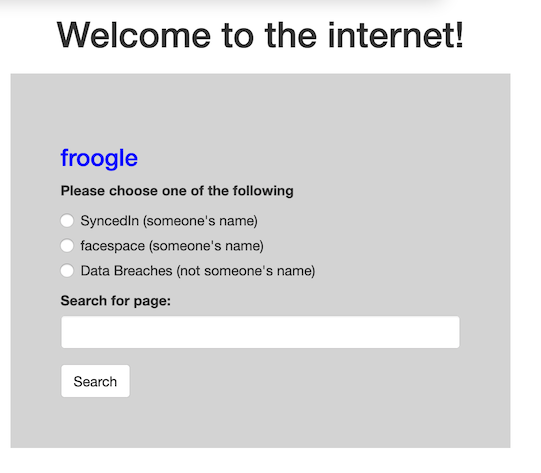

As you can see, they had three different services you could search: professional and casual social media pages and a data breach page (our version of LinkedIn, Facebook, and HaveIBeenPwned). The social sites you could search by person's name but you need some other data to search the breaches.

### The Target

All the problems were focused around a penetration test of "Burke Defense Solutions and Management." Their homepage could be found from the internet site also. [https://theinternet.ctf.umbccd.io/burkedefensesolutions.html](https://theinternet.ctf.umbccd.io/burkedefensesolutions.html)

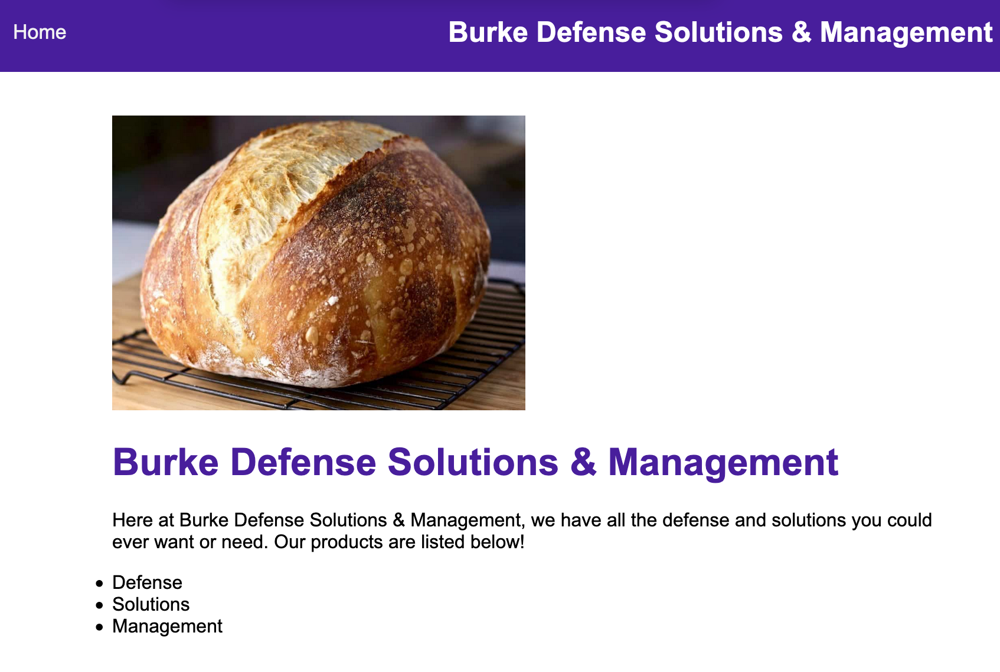

### The Challenges

Ok, lets find out everything we can about Burke Defense.

#### Problem 1 - 50 points
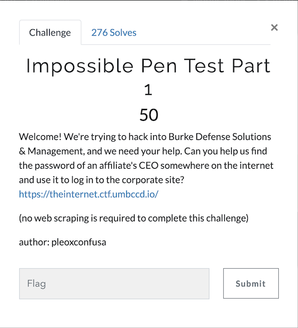

So, an affiliate company's CEO... lets see what people we can learn about from the Burke Defense Homepage. Scrolling down, we see a message from the CEO of Burke Defense thanking some affiliates.

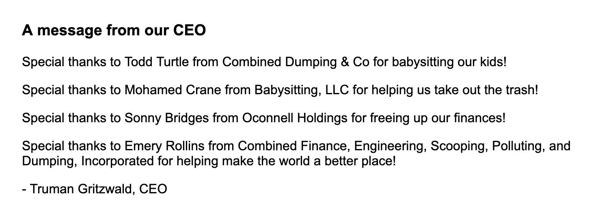

Ok, we have five names now. The BDSM (let's not use that acronym) CEO and four affiliate CEOs. Looking up each on both SyncedIn and FaceSpace we find out a few things about them.

{:class="table table-bordered"}
| Name        | email           | Employeer  | Other Names |
| ------------- |-------------| -----| --- |
| Truman Gritzwald | trumangritzwaldwix@fragile.com | CEO - Burke Defense Solutions & Management |  _Spouse_ - Trudy Gritzwald <br /> _Corporate Colleague_ - Madalynn Burke <br /> _CFO_ - Fired Unamed <br /> _CTO_ - Isabela Baker |
| Todd Turtle | 	oxmf1yyzeka@sticky.com | Combined Dumping & Co |  _Spouse_: Lauryn Turtle <br /> _Hotel_: Charriott International  |
| Mohamed Crane | cranemohameduuddyq@wemail.cc<br/>mohamedc@chubby.com| Babysitting, LLC | _Spouse_: Kevin Crane<br />_Parent_: Zachary Crane<br />_Grandparent_: Truman Booker<br />_Hotel_: Charriott International |
| Sonny Bridges |bseok@parcel.com | Oconnell Holdings | _Hotel_: Charriott International |
|Emery Rollins | rollinsemery@wemail.com <br/> emeryrdzbiu@shy.com | Combined Finance, Engineering, Scooping, Polluting, and Dumping, Incorporated | _Sibling_: Iyana Rollins<br />_Hotel_: Charriott International |

So we have three of the affiliate CEOs mention that they stay at Charriott International, and then on Facespace, the fourth (Emery Rollings) posts the following message.

> OMG just found out about the charriottinternational data breach repo!

So, lets go see if we can search that breach data for Chariott Internatonal. Sure enough, over 39,000 email addresses and passwords are found when searching data breaches for `charriottinternational`. Originally found [here on the CTF site](https://theinternet.ctf.umbccd.io/SecLists/charriottinternational.txt), but you can now find it [here locally](../assets/scripts/dawgctf/charriottinternational.txt). With some command line kung fu and a simple list of the emails, we can try to find some password leaks of interest.

```bash
$ cat affilate_emails.txt
oxmf1yyzeka@sticky.com
cranemohameduuddyq@wemail.cc
mohamedc@chubby.com
bseok@parcel.com
rollinsemery@wemail.com
emeryrdzbiu@shy.com

$ for email in `cat affilate_emails.txt`; do grep $email charriottinternational.txt; done
bseok@parcel.com        fr33f!n@nc3sf0r@ll!
```
So, Sonny Bridges had his password included in the Charriott International data breach. We now will try and login to the Burke Defense website with those credentials.

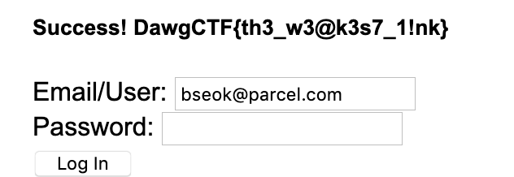

and we get back the following message:
`Success! DawgCTF{th3_w3@k3s7_1!nk}`

---

#### Problem 2 - 50 points
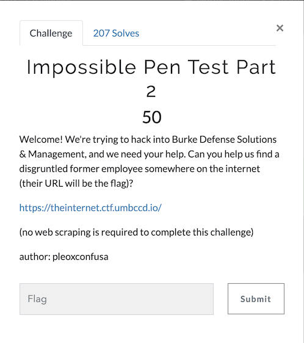

Ok, now we need to find a disgruntled former employee. We see that Truman mentioned a fired CFO, so that might be who we are looking for, but we cannot search by title. So lets look at the other two current (or maybe former) Burke Defense employees that we know from Truman's post (Madeyln Burke and Isabela Baker).

Using both SyncedIn and FaceSpace, we complete a table of information as before:

{:class="table table-bordered"}
| Name        | email           | Position at Burke Defense  | Other Names |
| ------------- |-------------| -----| --- |
| Madeylnn Burke | 5eh9rn@trap.io | CISO (left Jan 2020) | _Grandchild:_ Fernando McMahon<br />Child: Madalynn Burke <br /> _Company_: Spot (data breach)<br /> _CTO_: Royce Joyce|
| Isabela Baker | bisabelagjd9v1@fml.com <br />bisabela@salty.com <br />isabelabakerl4@wemail.com <br />isabelabakerqj1hc@yam.com <br />isabelabo9y6f@advertisement.gov <br />ibakerq6z6u4@trick.tk | CTO (current) | _Complicated_: Drew Green <br />_Company_: Spot (data breach) |

Some interesting things on these two individuals. First of all, Madeylnn is a former employee but does not post andything to make us thing she is disgruntled. In fact, a few days before her departure, Truman posts about a great meeting. So I don't think that's our employee. 

But we do get the name of another Burke Defense Employee and find two mentions of another data breach. Royce Joyce mentioned as the CTO so he will be useful to find additional employees. The company Spot has suffered a data breach with another 43,000 emails and passwords. The spot file could originally be [found here](https://theinternet.ctf.umbccd.io/SecLists/spot.txt) but can now be found [locally here](../assets/scripts/dawgctf/spot.txt). 

We can start a file for current or past Burke Defense employee email addresses so we can search for leaked passwords. 

```bash
$ cat burke_emails.txt
trumangritzwaldwix@fragile.com
5eh9rn@trap.io
bisabelagjd9v1@fml.com
bisabela@salty.com
isabelabakerl4@wemail.com
isabelabakerqj1hc@yam.com
isabelabo9y6f@advertisement.gov
ibakerq6z6u4@trick.tk

$ for email in `cat burke_emails.txt`; do grep $email spot.txt; done
5eh9rn@trap.io	C1S0!sN0C70
bisabela@salty.com	H0ld1ng5!sN0So1u7i0n5

$ for email in `cat burke_emails.txt`; do grep $email charriottinternational.txt; done
```

So we have found some more dumped credentials for a person of interest (current CTO, Isabela Baker) but luckily for them (unlucky for us), those are not valid for the Burke Defense homepage.

Let's gather some information about Royce Joyce now from SyncedIn and FaceSpace.

{:class="table table-bordered"}
| Name        | email           | Position at Burke Defense  | Other Names |
| ------------- |-------------| -----| --- |
| Royce Joyce | roycejoyce@wemail.net<br />jr7lp@homeschool.com | CTO (present) | _Company_: skayou(data breach)<br />_The Team_:<br /> Carlee Booker<br />Lilly Lin<br /> Damian Nevado<br /> Tristen Winters<br /> Orlando Sanford<br /> Hope Rocha<br />Truman Gritzwald|

Wow... thanks Royce! Six more new members of the team and another data breach. 

{:class="table table-bordered"}
| Name        | email           | Position at Burke Defense  | Other Names |
| ------------- |-------------| -----| --- |
| Tristen Winters | wintersttd@flow.com | Chief Information Security Officer (current)  | _Ignore_:Rudy Grizwald |
| Lilly Lin | ll0v@gullible.cc | Windows Admin (June 2019) | _Relative_: Isaias Lin |
| Damian Nevado | dnevadoame@homeschool.com | Expert in Cryptocurrency (left in Aug 2019)  | _Relative_: Caleb Nevado |
| Hope Rocha | hrocha@thread.com | Linux Admin (left Aug 2019) | _Relative_: Zaria Mcintosh<br />_New Linux Admin at Burke_: Guillermo McCoy |
| Carlee Booker | cbookerq3j@wemail.edu<br />bookerc7qfz@homeschool.com | Security Analyst (left Sep 2019)  | Mollie Page<br />_Relative_: Todd Meyer |
| Orlando Sanford | osk52hx@fml.com | Help Desk Worker (current)  | _Relative_: Dwayne Sanford<br />_Relative_: Alexus Cunningham |


With have two new non-relationship names from our Burke Defense employees above a new Linux Admin, Guillermo McCoy, being welcome to the team by Hope Rocha. We also have a new nameRudy Griwald who we are told to ignore his messages by Tristen Winters.

First, lets get the information about Guillernmo, it may be useful in the future (spoiler alert: it will be)

{:class="table table-bordered"}
| Name        | email           | Position at Burke Defense  | Other Names |
| ------------- |-------------| -----| --- |
| Guillermo McCoy | mccoyggwe3@yam.com<br />2jabjj5mm3m@stupid.io<br />gm5f@judicious.com<br />guillermomm3rcr@homeschool.com<br />mguillermo@wemail.cc | Linux Admin (current) | _Spouse_: Kenny McCoy |


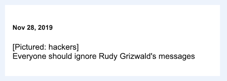.

Let's go see what he actually said on (I assume) FaceSpace. 

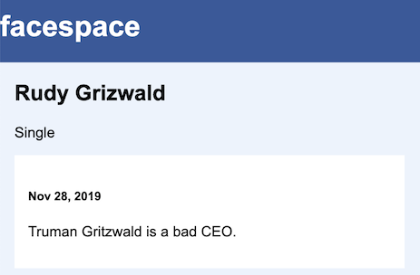

And this lines up with the date where Truman announced the firing and Rudy's job history on SyncedIn.

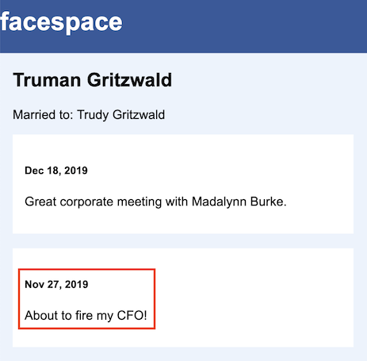
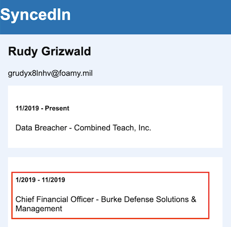

As the prompt said, the URL would be the flag, and both SyncedIn and Facespace URLs for Rudy Grizwald end with `DawgCTF{RudyGrizwald}`, so part 2 complete.

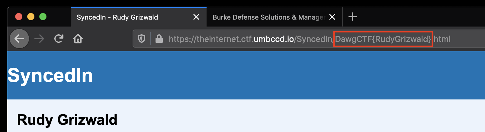

#### Interlude

Before we move to the third challenge, lets keep up to date with our former and current employees of Burke Defense and the data breaches.

The data breach at Skayou was originally [here](https://theinternet.ctf.umbccd.io/SecLists/skayou.txt) and now is [here](../assets/scripts/dawgctf/skayou.txt).

Updating our Burke email list and comparing to the three data breaches now, we see 

```bash
$ cat burke_emails.txt
mccoyggwe3@yam.com
2jabjj5mm3m@stupid.io
gm5f@judicious.com
guillermomm3rcr@homeschool.com
mguillermo@wemail.cc
5eh9rn@trap.io
bisabela@salty.com
bisabelagjd9v1@fml.com
bookerc7qfz@homeschool.com
cbookerq3j@wemail.edu
dnevadoame@homeschool.com
hrocha@thread.com
ibakerq6z6u4@trick.tk
isabelabakerl4@wemail.com
isabelabakerqj1hc@yam.com
isabelabo9y6f@advertisement.gov
jr7lp@homeschool.com
ll0v@gullible.cc
osk52hx@fml.com
roycejoyce@wemail.net
trumangritzwaldwix@fragile.com
wintersttd@flow.com
grudyx8lnhv@foamy.mil

$ for email in `cat burke_emails.txt`; do grep $email charriottinternational.txt; done

$ for email in `cat burke_emails.txt`; do grep $email spot.txt; done
5eh9rn@trap.io	C1S0!sN0C70
bisabela@salty.com	H0ld1ng5!sN0So1u7i0n5

$ for email in `cat burke_emails.txt`; do grep $email skayou.txt; done
roycejoyce@wemail.net	c0r^3cth0rs3b@tt3ryst@p\3
```
It appears our CTO's password has been leaked, and still works (but we will talk about that below)

---

#### Problem 3 - 100 points
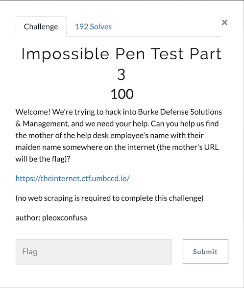

The effort put in above to enumerate all the Burke Employees is going to be be beneficial here. We see a help desk worker already.

{:class="table table-bordered"}
| Name        | email           | Position at Burke Defense  | Other Names |
| ------------- |-------------| -----| --- |
| Orlando Sanford | osk52hx@fml.com | Help Desk Worker  | _Relative_: Dwayne Sanford_Relative_: Alexus Cunningham |

We see on the help desk employees FaceSpace page they are married to Dwayne Sanford and their mom has a cat which she likes to throw out the window.

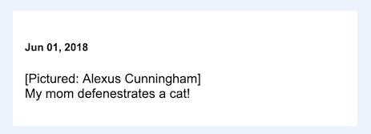
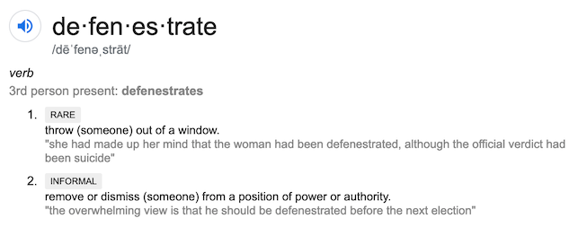
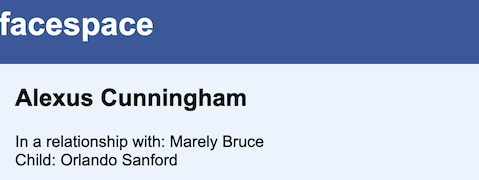

The mom's name is Alexus Cunningham and both her SyncedIn and FaceSpace account URL end with `DawgCTF{AlexusCunningham}`

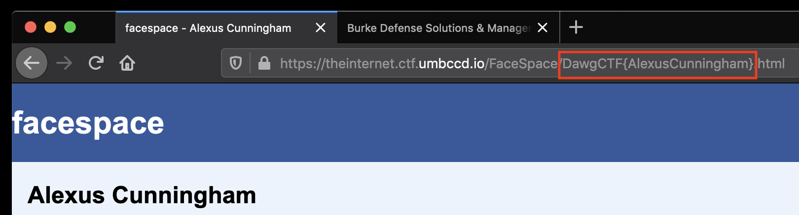

---

#### Problem 4 - 100 points
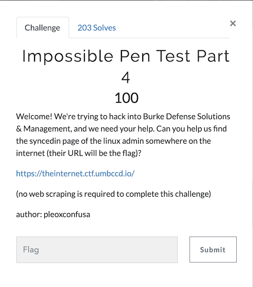

Having followed all thread above, we know of two Linux Admins at Burke Defense. Hope Rocha has moved on as of August 2019 and Guillermo McCoy is currently employeed.

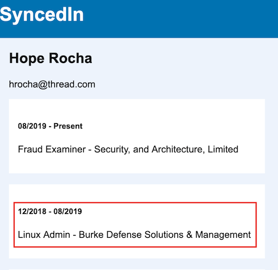
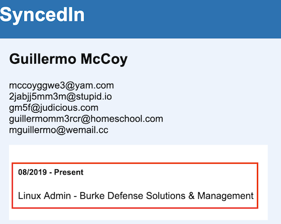

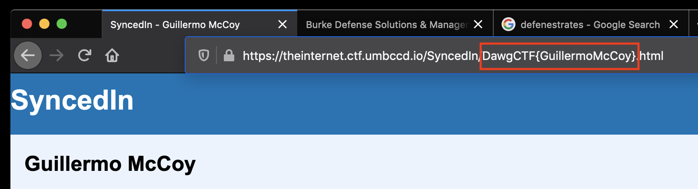

Guillermo's page URLs end with `DawgCTF{GuillermoMcCoy}`

---

#### Problem 5 - 100 points
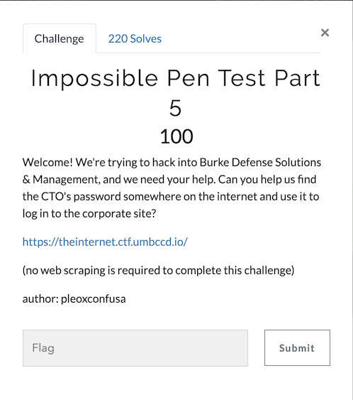

Oh yeah, the CTO's password. We have already seen this.

```bash
$ for email in `cat burke_emails.txt`; do grep $email skayou.txt; done
roycejoyce@wemail.net	c0r^3cth0rs3b@tt3ryst@p\3
```
So lets see if it works on Burke Defense homepage.

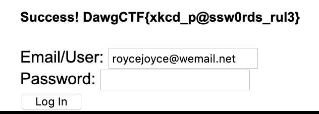

Sure, enough... Last flag `DawgCTF{xkcd_p@ssw0rds_rul3}`

##### Notes:

Besides the URLs that were for individuals that were flag, the URLs end with `DogeCTF{FirstLast}`. As Doge is the internet meme dog (or dawg)... that is pretty funny. Well played, UMBC Cyber Dawgs, well played!
