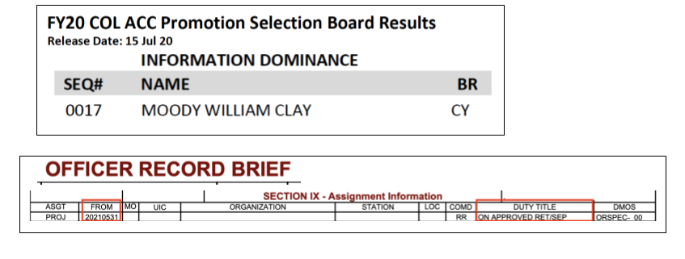

Wow… it's been quite a day. I have been overwhelmed with all the emails, texts, calls, slack messages, owls and carrier pigeons, etc congratulating me on 
promotion list news this morning. Each and every message means so much to me.

Yes, I was selected for promotion to “full-bird” Colonel this morning. The selection rate across the Army was a little less than 50% and was a 
little over 50% for my population (Cyber Officers). That does not include the great Americans who retired when they reached 20 years, a milestone 
that we all passed during the last 2 years. This selection is a testament to the many leaders, peers, subordinates, friends, and family who have been with me on this adventure.

But, also today I got word that “big Army” has approved my request to retire. Many have asked me if the promotion news changes my plans. I am glad 
to say that NO, I still will retire. It's been a great career and I have been blessed and honored to serve my country for the past two decades plus. This was a family decision. My amazing wife and kids have followed (and sometimes led) me across the world during my time in and out of uniform. 13 times our house has been packed by movers (or ourselves); we have resided in 7 states; and I have officially traveled to 7 different countries. And the Army got me three college degrees.

But every good journey must come to an end. So come June 1st 2021, I will join many heroes, patriots, scholars, and warriors on the Army’s retired roster. 
But I am not done yet, I am excited to continue to serve these next 11 months and do great things for the US Army, the Army Cyber Institute, the Army Cyber 
School, and the Defense Digital Service.

- Clay

“Immeasurably More” - Ephesians 3:20

top image source: https://thumbor.forbes.com/thumbor/960x0/https%3A%2F%2Fspecials-images.forbesimg.com%2Fdam%2Fimageserve%2F805095188%2F960x0.jpg%3Ffit%3Dscale
