*Puns, police snowmobiles, hidden messages, and a few things nobody actually needed to solve.*

In December 2017, the folks at SANS and Counter Hack Challenges released another edition of the [Holiday Hack Challenge](https://www.holidayhackchallenge.com/2017/). This one was called *Wintered*, and the North Pole was having a bit of a problem with giant snowballs.

That year's Holiday Hack was a little different for me. I had played the challenges in 2015 and 2016, but in the summer of 2017 I got the opportunity to work with the Counter Hack crew, helping develop content for SANS NetWars and Holiday Hack. I even got to spend some time in the secret room where the sausage was made.

One of my assignments involved the North Pole Police Department (NPPD) website. There was an official challenge associated with the website and an intended solution. That is not really what I want to talk about here.

This is the story of all the *other* stuff I put into it. The little jokes, callbacks, visual touches, encoded messages, and Easter eggs that made a fictional police department feel a little less fictional.

I might have gotten a little carried away.

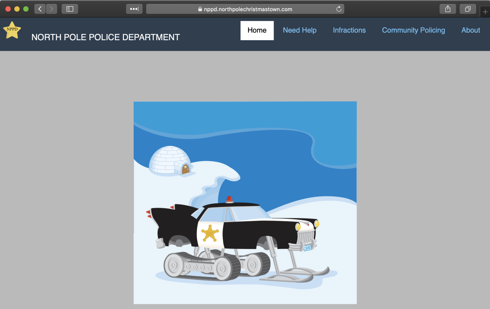

<!--more-->

## Every good police department needs a snowmobile

I figured that if we were going to build a North Pole Police Department, it should at least have a respectable police vehicle. An ordinary cruiser wouldn't cut it. I found an image of a police snowmobile, complete with a sheriff's star and flashing light, and put it front and center on the homepage.

The site had all the proper sections: Home, Need Help, Infractions, Community Policing, and About. It looked official enough, provided you didn't read too carefully.

Of course, I was hoping people *would* read carefully.

## All the news that's fit to pun

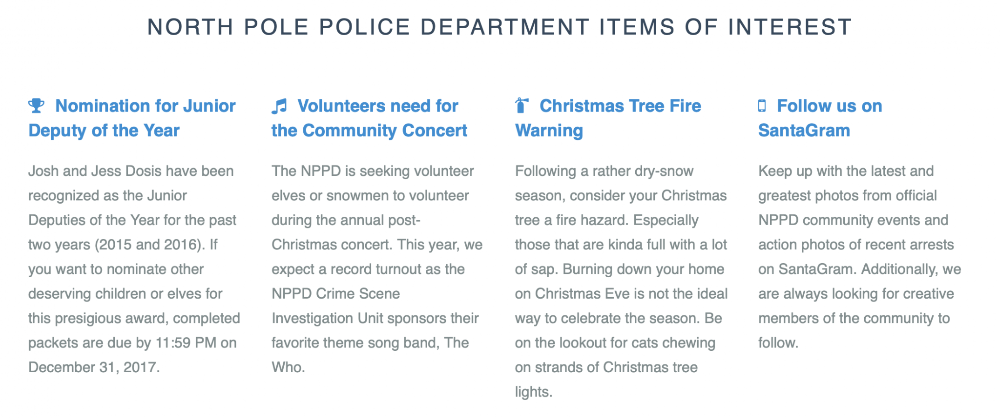

The homepage had a collection of routine announcements. Routine for the North Pole, anyway.

**Junior Deputies of the Year.** The department congratulated **Josh and Jess Dosis** for earning the honor in 2015 and 2016. Longtime Holiday Hack players would recognize the Dosis family from those earlier challenges. It was my little nod to the people who had been coming back year after year. And, naturally, nominations for the next deputies had a December 31 deadline. We run a tight ship up north.

**The CSI concert.** We were looking for volunteers for a concert sponsored by the **NPPD Crime Scene Investigation Unit**, whose favorite band was **The Who**. That's because all the various *CSI* television shows used songs by The Who as their themes. An absolutely essential piece of police procedural trivia.

**Christmas tree fire warnings.** Residents were cautioned about dry trees, especially ones that were "kinda full with a lot of sap." That's a *National Lampoon's Christmas Vacation* reference. Clark Griswold would probably have appreciated the advance warning. The announcement also included a warning about cats chewing Christmas lights, because apparently the NPPD handled a lot of holiday hazards.

**SantaGram.** We encouraged folks to follow the department on **SantaGram**, another callback, this time to the social media site from Holiday Hack 2016.

None of that was the official answer. These were just little rewards for reading the scenery instead of racing straight to the next flag.

## Sheriff Coaltrane has been here since the epoch

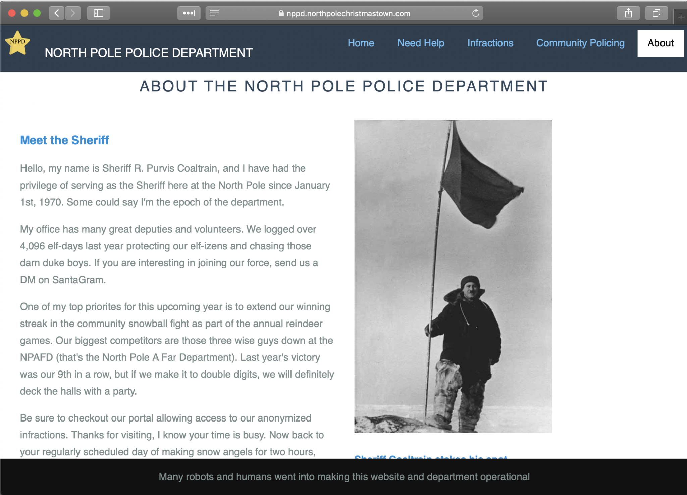

Naturally, our police department needed a sheriff. Enter **Sheriff R. Purvis Coaltrane**.

If you watched *The Dukes of Hazzard*, you probably recognize the reference to Sheriff Rosco P. Coltrane. And if you somehow missed it, the sheriff's complaint about chasing those **"darn duke boys"** was there to help.

According to his biography, the sheriff had served the department since **January 1, 1970**. Some folks, he explained, called him the **"epoch of the department."** For anyone who has worked with Unix timestamps, January 1, 1970 is the beginning of the Unix epoch. So the sheriff had been there since the beginning of time. At least the kind of time computers like to count.

His department had logged **4,096 elf-days** protecting the local elf-izens. A nice, binary-friendly number, if you happen to think in powers of two.

And then there was his pride in the department's annual snowball-fight record against the **North Pole A Far Department (NPAFD)**, those **three wise guys from afar**. Yes, that's a three-wise-men joke. No, I am not apologizing.

One line at the bottom of the About page was a little less random than it looked:

> Many robots and humans went into making this website and department operational.

That was a clue, of sorts. More on that in a moment.

## Need help? Wave your mouse around

The Need Help page explained how to summon the police in an emergency: move your mouse back and forth over the site's menu bar. Apparently doing it from the Infractions page produced "optimal results."

Why would a police department give such peculiar instructions? Because I made the menu light up like a police siren when you moved the cursor over it.

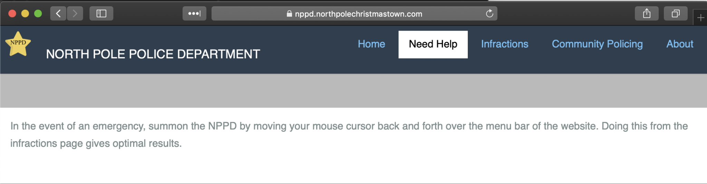

Here's the original animation preserved in my presentation:


It didn't need to exist. I just thought it would be funny if you could call the North Pole police by frantically waving your mouse over a navigation bar. Sometimes that is all the justification a feature needs.

## The message in the stars

There was another Easter egg hiding in plain sight: the little gold, five-pointed NPPD badge used as the site's favicon.


I used **least-significant-bit (LSB) steganography** to conceal information in that tiny icon. The favicon included an embedded **GitHub URL pointing to the LSB-steganography repository I had used**. That was a deliberate breadcrumb. A lot of Holiday Hack players captured their network traffic in PCAP files and examined it in Wireshark. I was hoping someone would pull down the site's favicon during that process, investigate it, and notice there was more to the star than met the eye.

There was another hidden surprise as well. Following the steganography trail revealed:

> Keep the change, you filthy animal

A little *Home Alone* reference, because of course it was.

The idea for the favicon Easter egg came from my son, and I was happy to give him credit for it. The only problem was that nobody seemed to be finding the thing. So on January 11, 2018, I dropped a hint on Twitter asking whether anyone had unlocked **"Find The Message in the Stars."**

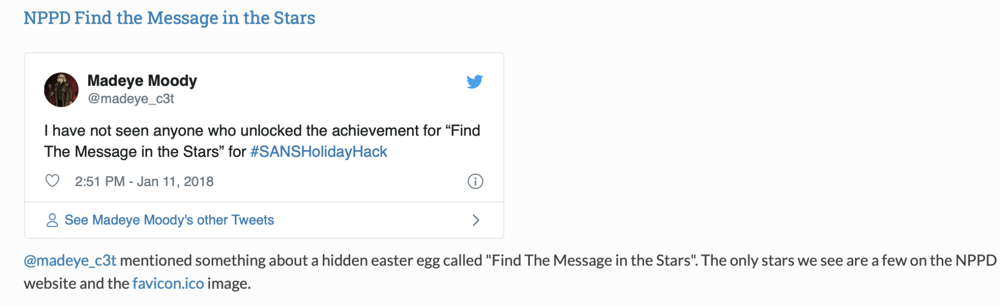

That got people looking. One player traced the clue to `favicon.ico`, investigated it with LSB steganography, and recovered the hidden message. We even exchanged a few messages afterward, and the player was gracious enough to give my son some kudos for the idea.

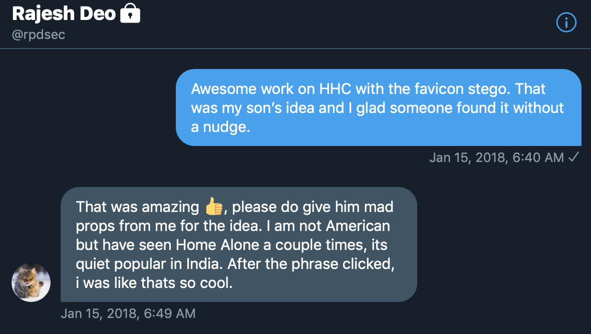

It's a funny thing about hiding Easter eggs: you spend time making them difficult to find, and then get disappointed when people don't find them. Go figure.

## These aren't the droids you're looking for

Remember that "robots and humans" line at the bottom of the About page? Well, `robots.txt` is a perfectly normal file to check when you're poking around a website. The NPPD's version was not entirely normal.

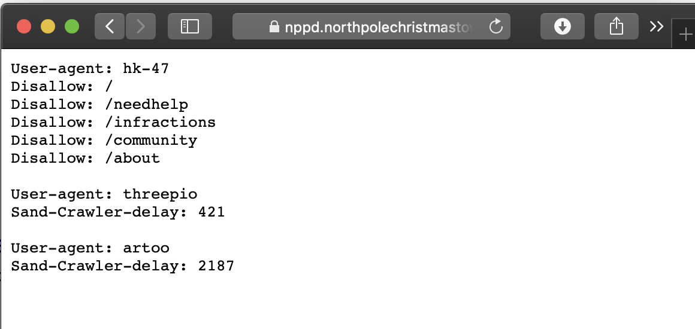

Instead of ordinary web crawlers, I gave it three Star Wars-inspired user agents:

```text
User-agent: hk-47
Disallow: /
Disallow: /needhelp
Disallow: /infractions
Disallow: /community
Disallow: /about

User-agent: threepio
Sand-Crawler-delay: 421

User-agent: artoo
Sand-Crawler-delay: 2187
```

**HK-47** is the assassin droid from *Star Wars: Knights of the Old Republic*. **Threepio** and **Artoo** are, of course, C-3PO and R2-D2. And why have an ordinary crawler delay when you could have a **Sand-Crawler-delay**?

The numbers weren't random either. **421** points to TK-421, the missing stormtrooper mentioned aboard the Millennium Falcon in *A New Hope*. **2187** is a reference to Princess Leia's detention cell on the Death Star.

The Star Wars jokes were also a little nod to the Star Wars-themed SANS NetWars challenges I had helped write earlier that year. Apparently I wasn't ready to leave the droids behind.

## Humans deserve a file, too

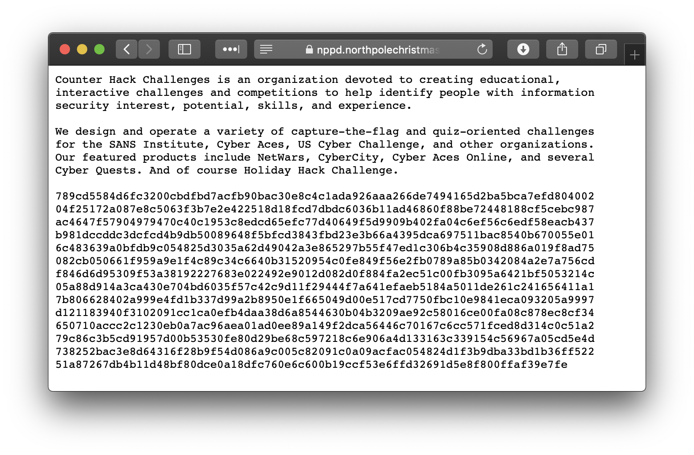

Unlike `robots.txt`, which provides instructions for automated crawlers, [`humans.txt`](https://humanstxt.org/) is a real convention for giving credit to the people who create a website. So it seemed like a pretty good place to leave a personal note.

At first, the NPPD's `humans.txt` looked respectable: it described Counter Hack Challenges and the work they did building cybersecurity challenges, including NetWars and Holiday Hack.

Then came an enormous string of hexadecimal characters.

You know, normal website credits.

The string began with `789c`, which is a recognizable signature for a common zlib-compressed data stream. Convert the hexadecimal into bytes and decompress it, and you get another encoded layer. Decode that Base64, and out comes an old-fashioned, text-rendered **punch card**.

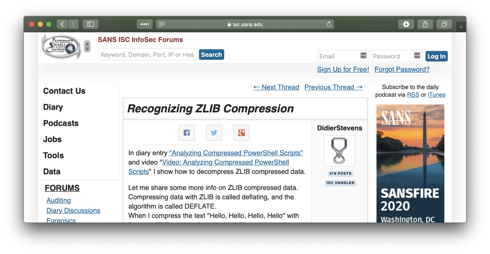

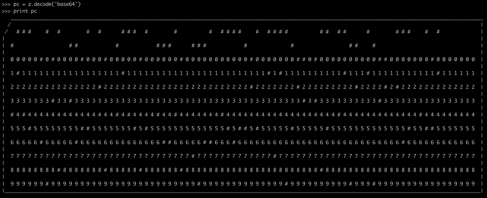

So the decoding path was:

**Hex → zlib → Base64 → punch card → message**

Why a punch card? Because sometimes the best way to hide a message in a modern website is to drag the reader back several decades in computing history. It also gave me an excuse to use a photograph of an old card-punch machine in the presentation.

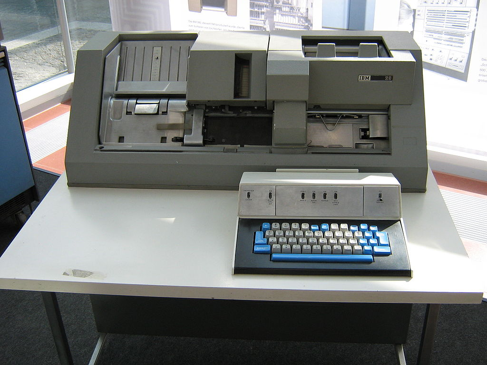

The decoded message read:

```text
MADE WITH LOVE BY MADEYE MOODY PROF DEFENSE
AGAINST THE DARK ARTS BFE 4EVA
```

That's an awful lot of work just to leave a signature. But there was a little more to it than that.

## Hogwarts on the Hudson

In 2017, I was an Assistant Professor of Computer Science at the United States Military Academy at West Point. I sometimes called the place **"Hogwarts on the Hudson"**, and the cybersecurity curriculum I taught was, naturally, **Defense Against the Dark Arts**.

My longtime hacker handle was **Madeye Moody**, a nod to the *Harry Potter* character who taught that very subject and had a particular fondness for **"Constant Vigilance!"** If you've ever wondered where the name of this blog came from, now you know.

I was also coaching West Point's competitive cyber team, **Bits For Everyone (BFE)**. The cadets competed in CTFs, solved interesting problems, and spent a fair amount of time staring at terminals. You can still find [Bits For Everyone on CTFtime](https://ctftime.org/team/2511).

So **"BFE 4EVA"** was a shout-out to those cadets, and the rest of the message was a nod to my own strange little intersection of computer science, cybersecurity, West Point, and Harry Potter.

A personal note from Hogwarts on the Hudson, hidden inside a punch card, wrapped in Base64, compressed, and hex-encoded in a file most visitors would never open.

Much subtler than signing the footer, don't you think?

## When somebody else takes the joke even further

One of the most fun parts of Holiday Hack was reading the player write-ups after the challenge. People would document the solutions, dig up obscure clues, and sometimes notice details I had almost forgotten putting in there.

The group **The Three Stagers** took creativity to another level. They won the official **Best Creative Answer** award for 2017, in part for producing a spoof magazine called ***The Hack*** as part of their submission.

**Important credit:** I did **not** create this magazine. It was the players' work, and that's what makes it such a fun ending to this story.

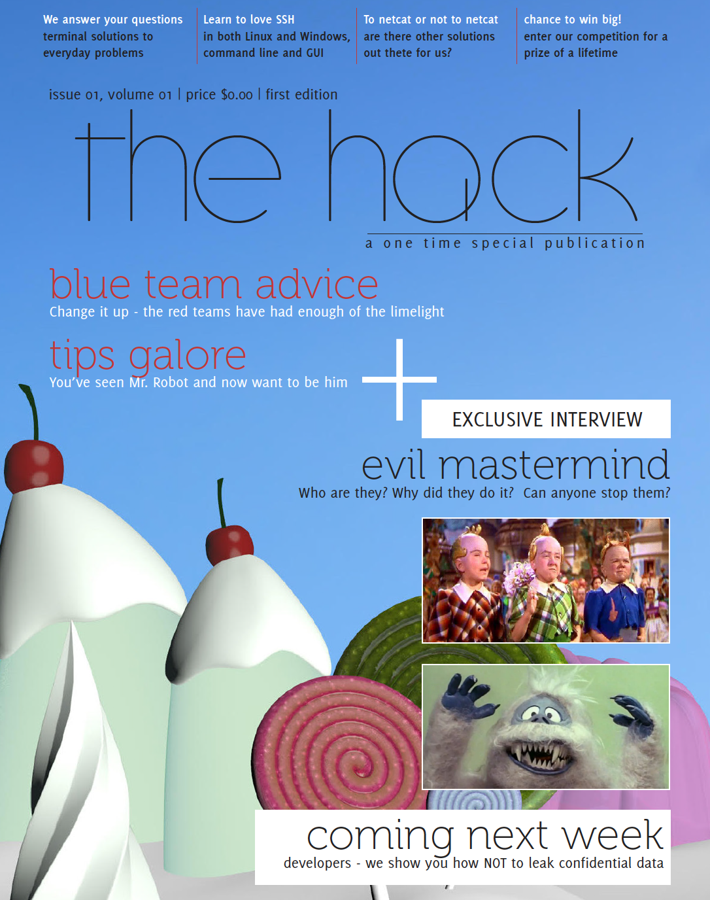

The team found my punch-card message and turned it into part of the narrative of their magazine. Suddenly Madeye Moody was a character who could be reached by owl messenger using **IP over Avian Carriers (IPoAC)**. They even reproduced the punch card and included an image of the professor.

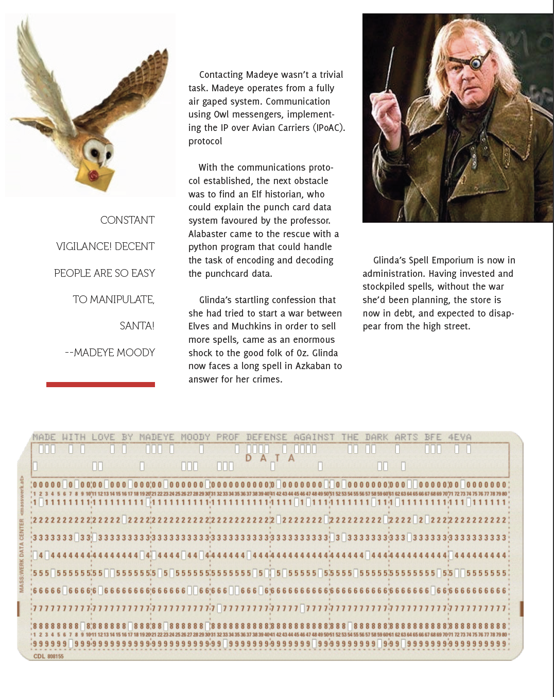

I'd put the message in there as a joke and a signature. They found it, understood the reference, and used it to build out the story even more. That was pretty cool.

The full magazine is still available as part of the [official 2017 winners and answers](https://www.holidayhackchallenge.com/2017/winners_answers.html), and you can [read *The Hack* directly](https://www.holidayhackchallenge.com/2017/winners/the_hack_magazine.pdf).

## So what?

Most of the things I've talked about here were not necessary to solve the official Holiday Hack challenge. They were the *dressing* around the challenge. But that was part of the fun.

I love a good CTF problem, especially one that makes you learn something new. I also love the little moments when a challenge rewards you for being curious. A goofy announcement reminds you of a previous year's characters. A ridiculous sheriff turns out to have a Unix timestamp joke in his biography. A routine web file contains some Star Wars trivia. A favicon sends you down a steganography rabbit hole. And, if you stick with it, an ancient punch card tells you a little something about the guy who put it there.

The original NPPD website isn't available anymore, at least not as the interactive site players visited in 2017. Fortunately, I preserved screenshots in a presentation I gave to Clemson's cyber club in 2020. Some of those screenshots came from the original site and others from player write-ups. They are most of what I have left of that little corner of the North Pole, and they are the source of the images in this post.

Seeing the players discover those Easter eggs, and in the case of The Three Stagers actually extend the story themselves, was an incredibly rewarding part of working on Holiday Hack.

If nothing else, I hope it serves as a reminder that technical challenges don't have to be dry. A little story, some personality, and an unreasonable number of puns can go a long way.

Always check `robots.txt`. Sometimes check `humans.txt`. And never trust a sheriff who has been on duty since January 1, 1970.

**Constant Vigilance!**

---

### References and image credits

- [SANS Holiday Hack 2017, *Wintered*](https://www.holidayhackchallenge.com/2017/)
- [Official 2017 winners and answers](https://www.holidayhackchallenge.com/2017/winners_answers.html)
- [*The Hack* magazine by The Three Stagers](https://www.holidayhackchallenge.com/2017/winners/the_hack_magazine.pdf)
- [Bits For Everyone on CTFtime](https://ctftime.org/team/2511)
- [The humans.txt initiative](https://humanstxt.org/)

*Images were extracted from my 2020 Clemson cyber-club presentation. Some images are historical screenshots from third-party Holiday Hack write-ups. The two images from The Hack magazine are reproduced as examples of The Three Stagers' creative submission, not as my original work.*
